<p align="center">
  
</p>

<h1 align="center">Rice</h1>

<p align="center"><b>English</b> · <a href="README.pt-BR.md">Português</a></p>

Rice is a Mac app that records your meetings, transcribes them on your machine and writes the notes for you.

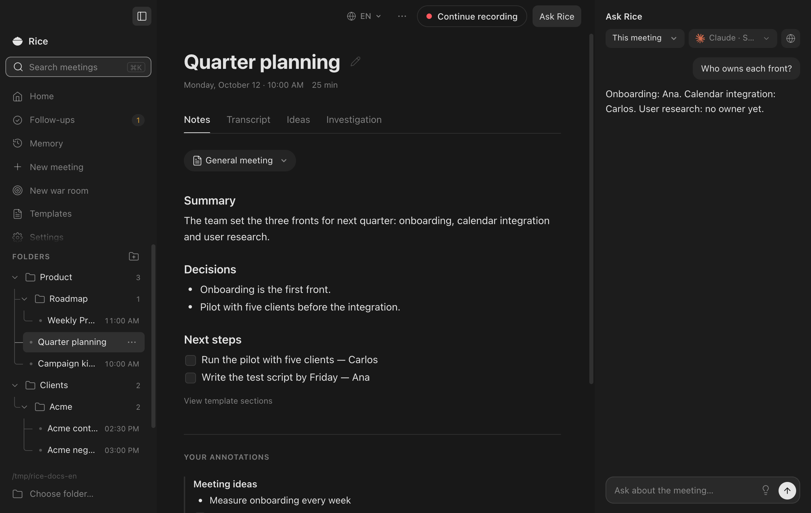

- **Local transcription.** Records your microphone and the system audio (the other participants) and transcribes with [whisper.cpp](https://github.com/ggml-org/whisper.cpp). The audio never leaves your Mac.
- **Notes written by an AI, from templates.** When the recording ends, Rice fills in the sections of a template (Summary, Decisions, Next actions…). You choose the AI: Claude, ChatGPT, Gemini or OpenCode.
- **Ask about the meeting.** A chat panel answers questions about what was said.
- **Folders.** Group your meetings in the sidebar, like folders in a notes app.
- **Search everything.** Find a word in the titles, notes, annotations and transcripts of all your meetings.
- **Ask across meetings.** One question, answered from the notes of the meetings that matter, with links to them.
- **Share.** Copy the notes formatted, write a follow-up email draft or export a PDF.
- **Mini Rice.** A small floating pill shows that you are recording, with **Ask** and **Stop** one hover away.

## Contents

- [Requirements](#requirements)
- [Install](#install)
- [First steps](#first-steps)
- [Connect an AI](#connect-an-ai)
- [Everyday use](#everyday-use)
- [Where your files live](#where-your-files-live)
- [Keyboard shortcuts](#keyboard-shortcuts)
- [Troubleshooting](#troubleshooting)
- [Privacy](#privacy)
- [License](#license)

## Requirements

- A Mac with **Apple Silicon** (M1 or newer). Intel Macs are not supported yet.
- **macOS 14 (Sonoma) or newer**. Rice uses the system audio capture that arrived in that version.
- **Xcode Command Line Tools** (`xcode-select --install`), to compile the small native audio helpers.
- [**Homebrew**](https://brew.sh), used to install `whisper.cpp` and the build tools.
- **Node.js 22** or newer.
- About **0.6 GB** of free disk space for the transcription model (it is downloaded the first time).
- An account or API key for at least one AI provider (see [Connect an AI](#connect-an-ai)). Transcription works without one; notes and chat need it.

## Install

Requires a Mac with Apple Silicon (arm64) and macOS 14 or newer. Transcription uses `whisper-server` from Homebrew (`brew install whisper.cpp`).

### Option 1 — for developers: build and install from source

```bash
git clone https://github.com/WalissonCF/rice.git
cd rice
./install.sh
```

`install.sh` checks macOS/arm64, the Xcode Command Line Tools, Homebrew and Node 22+, installs what is missing with Homebrew (`whisper.cpp meson ninja pkg-config`), runs `npm ci` and `npm run dist`, copies **Rice.app** to `/Applications` (replacing the previous one) and removes the quarantine flag. It is safe to run again, stops with a clear message (in Portuguese and English) when something is missing, and does not use `sudo` (only Homebrew may ask for it). `./install.sh --check` only checks the environment.

### Option 2 — download the .dmg

Download `Rice-<version>-arm64.dmg` from the **Releases** page, open it and drag **Rice** to **Applications**.

Rice is signed ad hoc and is **not** signed or notarized by Apple, so on the first launch macOS shows "Rice Not Opened". To allow it, run in Terminal:

```bash
xattr -dr com.apple.quarantine /Applications/Rice.app
```

Or, without Terminal: click **OK** on the warning, open **System Settings › Privacy & Security**, scroll to the bottom and click **Open Anyway** next to "Rice was blocked". (On macOS 15 and later, right-click > Open no longer lets the app through.)

Because it is not signed by Apple, macOS may ask for the permissions again (microphone, system audio, Calendar) after you update.

You still need `brew install whisper.cpp` for the transcription server; the transcription model itself is downloaded on first launch.

### Windows (x64, Windows 10 22H2 or 11) — work in progress

The Windows port is built and tested in CI, but has not been tried on a real PC yet. In PowerShell, from the repository folder:

```powershell
powershell -ExecutionPolicy Bypass -File install.ps1 -Check   # checks Windows, Node 22, CMake and the Visual Studio C++ tools
powershell -ExecutionPolicy Bypass -File install.ps1           # builds the helpers and the installer (dist\Rice-Setup-*.exe) and opens it
```

The installer is per user (no administrator) and unsigned: SmartScreen may show "Windows protected your PC"; choose "More info" and "Run anyway". Differences from the Mac: no Antigravity, no Reminders, no system Calendar (the agenda comes from Google), the keys are protected by Windows (DPAPI) and shortcuts use Ctrl.

### Running from source (development)

```bash
brew install whisper.cpp meson ninja pkg-config
npm install
node node_modules/electron/install.js   # downloads the Electron app shell
scripts/build-native.sh                 # native audio helpers (needs internet the first time)
npm run app                             # build and open Rice
```

Good to know:

- `scripts/build-native.sh` first builds the echo canceller (WebRTC audio processing, downloaded and checked against a fixed SHA-256), then the two Swift helpers. Next runs are fast.
- The transcription server is `whisper-server` from Homebrew. Rice expects it at `/opt/homebrew/bin/whisper-server`. If yours is somewhere else, start Rice with `RICE_WHISPER_SERVER=/path/to/whisper-server npm run app`.
- The transcription model is downloaded automatically on first launch into `~/Library/Application Support/Rice/models`, and checked with a SHA-256. By default Rice uses the quantized `large-v3-turbo` (about 0.6 GB). `RICE_WHISPER_MODEL=f16` switches to the full model (about 1.6 GB).
- To open Rice again later, open **Rice** from Applications (installed with the .dmg or `install.sh`), or run `npm run app` from the `rice` folder when running from source.

**Dock and Applications.** There is no `.app` bundle yet. While it runs, you can keep Rice in the Dock with right click on its icon › Options › Keep in Dock. *Coming soon: a `.dmg` and a Homebrew cask.*

## First steps

Open **How to use Rice** in the sidebar. It is a checklist that updates live.

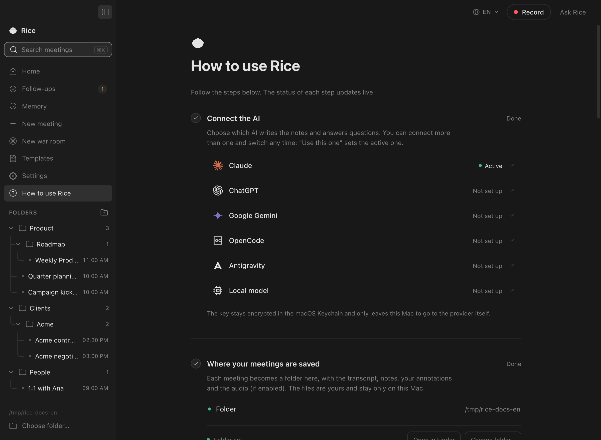

### 1. Choose where meetings are saved

Each meeting becomes a folder with the transcript, notes and chat. Pick the place under **Settings › Meetings folder** or in the guide (**Change folder…**). The files are plain Markdown, so you can open them with any app.

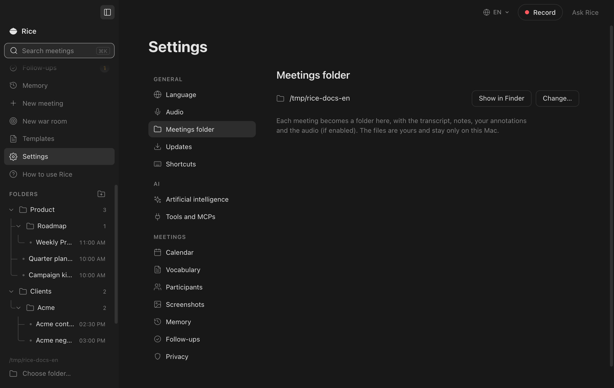

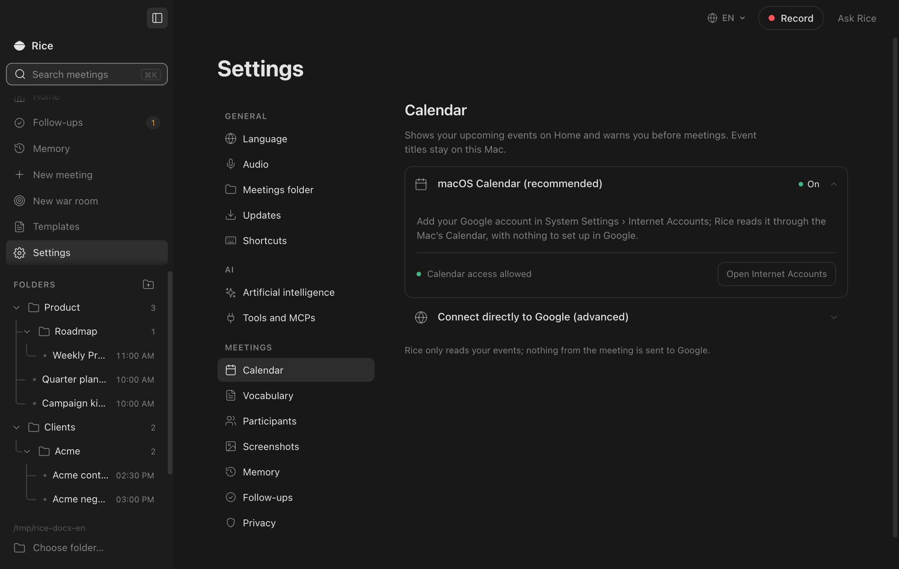

### 2. Allow the macOS permissions

On your first recording macOS asks for two things:

| Permission | Why | Where to allow it |
| --- | --- | --- |
| **Microphone** | So Rice hears you. | System Settings › Privacy & Security › Microphone |
| **System audio recording** | So Rice hears the other participants. | System Settings › Privacy & Security › Screen & System Audio Recording |

The guide has an **Open Privacy Settings** button. Enable **Rice** (while you run it from source it may be listed as **Electron**), then reopen the app if macOS asks you to.

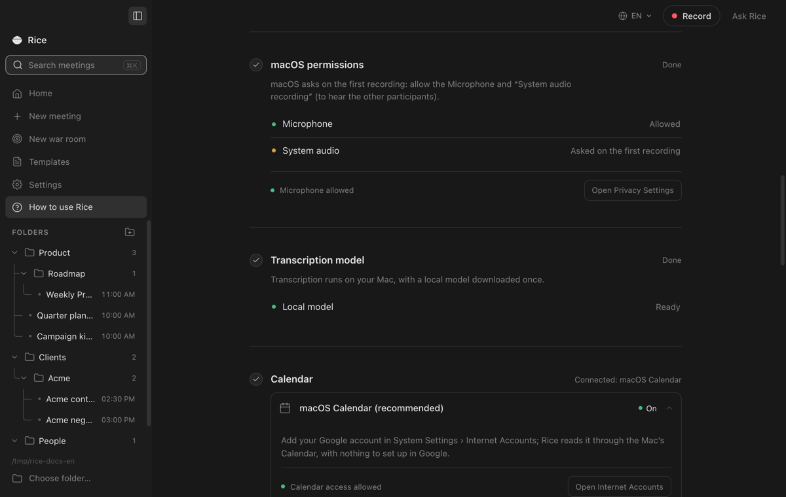

### 3. Let the model download

The guide shows the progress of the transcription model. When it says **Model loaded**, you can record.

## Connect an AI

Open **Settings › Artificial intelligence** (the same list appears in the **How to use Rice** guide). Each provider is one line, with the active AI on top; click a line to open its steps. You can connect more than one provider and switch at any time with **Use this one**.

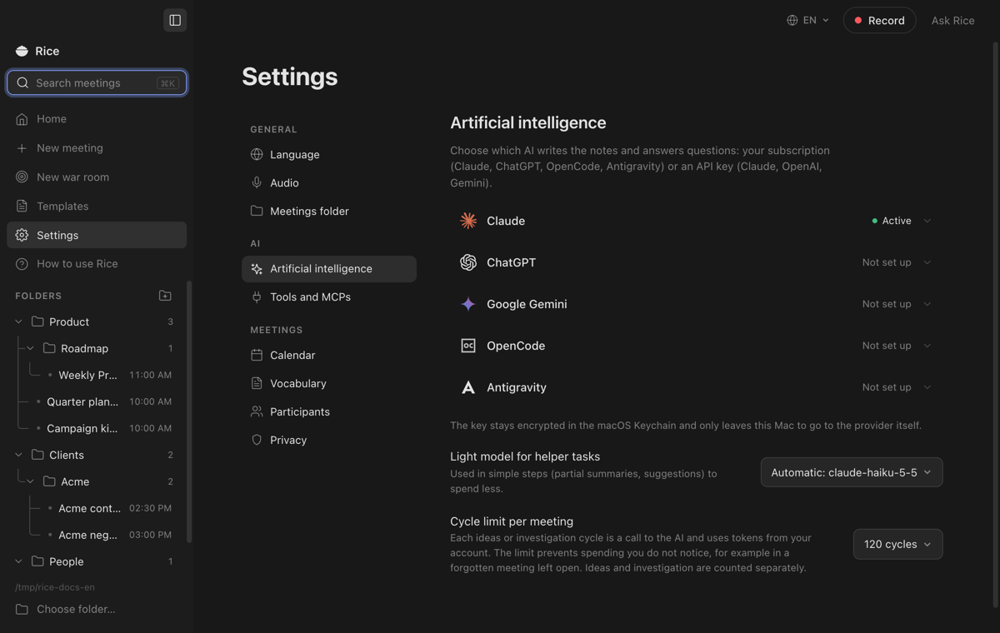

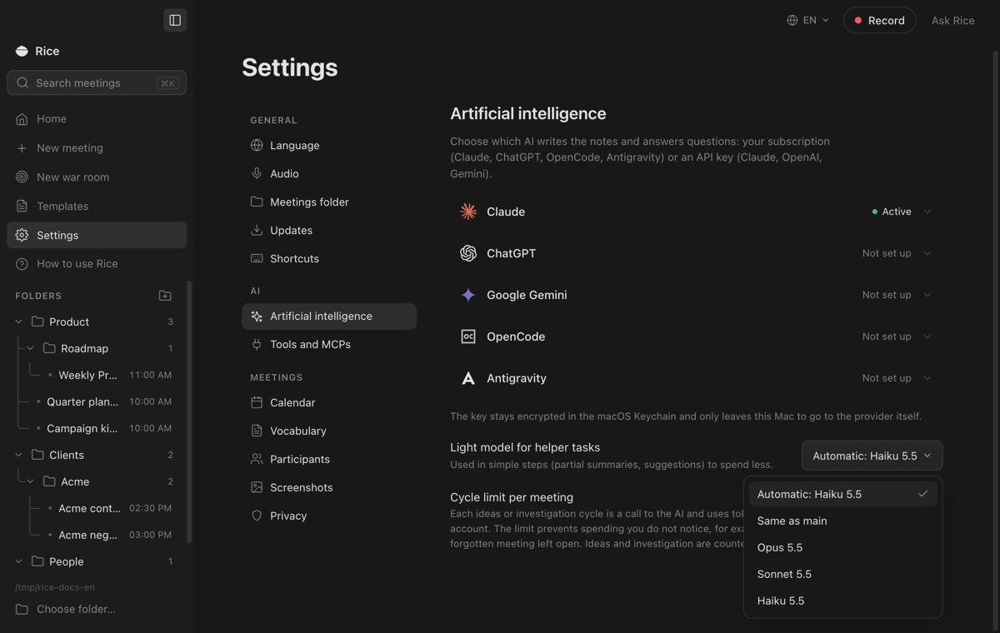

| Provider | Option | What you need |
| --- | --- | --- |
| Claude | Subscription | Run `claude setup-token` in Terminal, sign in on the browser, paste the token (starts with `sk-ant-oat`). |
| Claude | API key | Create a key at [console.anthropic.com](https://console.anthropic.com) › API Keys (starts with `sk-ant-api`). |
| ChatGPT | Subscription | Install the Codex CLI (`npm i -g @openai/codex` or `brew install codex`), run `codex login` and sign in with your ChatGPT account. Nothing to paste. |
| ChatGPT | API key | Create a key at [platform.openai.com](https://platform.openai.com) › API keys (starts with `sk-`). |
| Gemini | API key | Create a key at [aistudio.google.com](https://aistudio.google.com) › Get API key (starts with `AIza`). Google discontinued the Gemini terminal sign-in (CLI) for personal accounts in June 2026, so Gemini is API key only; if you had it set up by login, Rice switches you to a key (or to another verified AI) and tells you once. |
| OpenCode | Sign-in | Install the [OpenCode](https://opencode.ai) CLI, run `opencode auth login` and pick your subscription. Nothing to paste. See below. |
| Antigravity | Sign-in | Install the Antigravity CLI (`agy`) and run `agy` in Terminal to sign in with your account. Nothing to paste. See below. |

Then click **Test connection**.

- API keys and tokens are stored encrypted in the **macOS Keychain** (Electron `safeStorage`). They are never shown again and never sent anywhere except to the provider you chose.
- API usage is billed by the provider, separately from any subscription.

### OpenCode

Rice uses the OpenCode CLI you are already signed in to, just like Claude and ChatGPT. Install it with `curl -fsSL https://opencode.ai/install | bash` and run `opencode auth login` in Terminal, picking your subscription provider (Claude Pro/Max, ChatGPT Plus/Pro, GitHub Copilot, OpenCode Zen…). Then in Rice open Connect AI > OpenCode, choose a model (the list only shows providers you signed in to) and click Test connection. OpenCode runs only to generate text: every permission is denied (no file edits, commands, web access, MCP or plugins), in an empty folder, without inheriting other providers' keys. Automatic mode only uses models you signed in to; with none, Rice asks you to sign in. The free model (OpenCode Zen) is used only if you pick it from the list, and it may use your transcripts to improve models, so prefer your subscription for sensitive meetings.

### Antigravity (agy)

You can use your Antigravity subscription as the AI (Settings > Artificial intelligence > Antigravity). Because `agy` is an agent with file and terminal access, Rice runs it inside a macOS sandbox: it only generates text, can't write anywhere except an empty temporary folder, can't run commands and can't read your home folder. The conversation created on each use is deleted from the agy state. The prompt goes in through stdin, so it does not show up in the process list. In Rice, click Test connection and pick a model (the list comes from `agy models`; in Automatic mode the light model for simple steps is the smallest Flash). The agent still has web access, so Antigravity is not available for War room or for chat with tools. Responses take a few seconds longer than other providers (the agy takes ~4 s to start).

## Everyday use

### Record, stop and continue

Click **New meeting**, then **Record**. When you stop, Rice writes the notes. If the meeting is not over, open it later and click **Continue recording**: the new audio and transcript are added to the same meeting.

Rice also notices meetings (Zoom, Meet, Teams) and calendar events and offers to record.

### Notes versions

Generating the notes again (another template, or a new transcript) no longer loses the previous ones: the old notes are kept in `notas-versoes/` (up to 20, the oldest go first). A discreet **Versions (3)** chip next to the template chip lists them ("Brainstorm · today 4:40 PM · current"); picking one shows it read-only with a thin bar (**Back to current** / **Restore this one**). Search, chat, copy and PDF always use the current notes.

### Calendar

**Home** shows your next 7 days grouped by day (Today, Tomorrow, "Fri, Oct 17"). All-day events sit in one discreet line per day; timed events show their range ("09:00–09:30") and **Join** / **Take notes** only when they are meetings (a call link or attendees). Connect the **macOS Calendar** (recommended: add your Google account in System Settings › Internet Accounts) or Google directly in **Settings › Calendar**. Event titles stay on your Mac: only the title of a meeting you record is used, and all-day events never trigger a recording prompt.

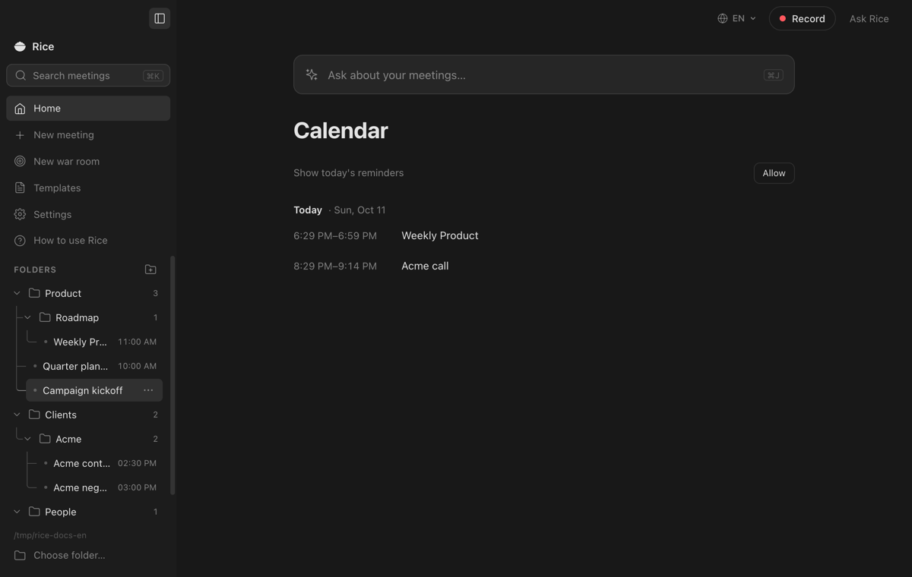

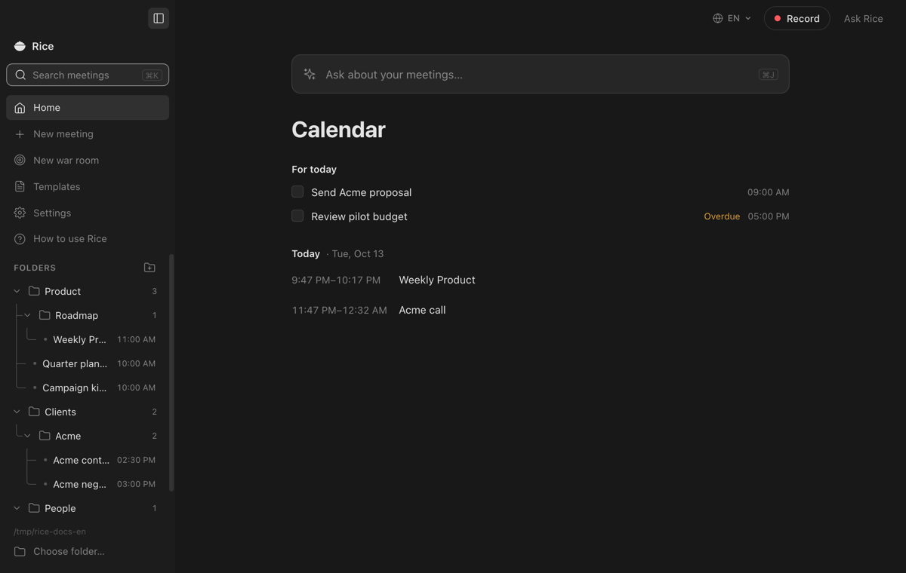

### Live transcript

The transcript appears while you talk. Grey text is still being refined and becomes final in a moment. Your voice is shown as **Me** and the other participants as **Others** (in the transcript file they are saved as `Eu` and `Outros`, and the app translates them when showing). You can write your own notes in **Annotations** at any time.

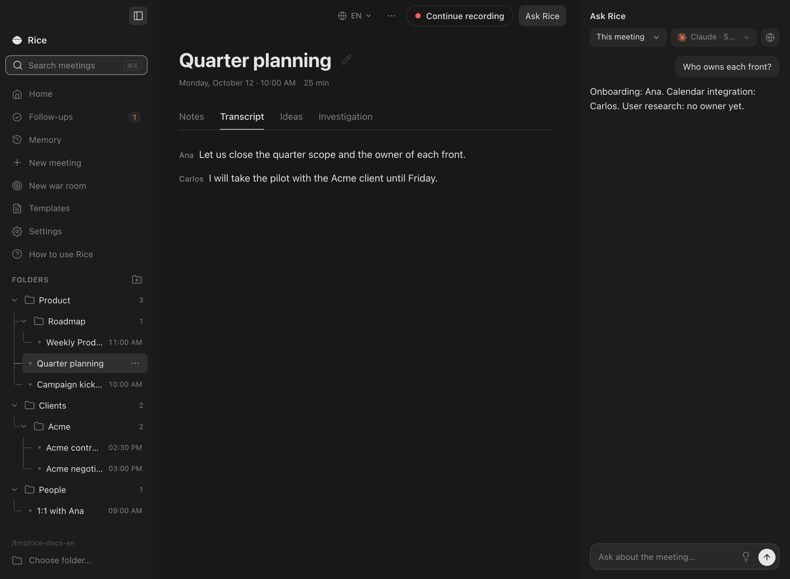

### Generate notes and change the template

Notes are written as soon as you stop. If they are missing or failed (for example, no AI connected yet), a **Generate notes** button appears. The chip above the notes (for example **General meeting**) switches the template, and the right side previews its sections.

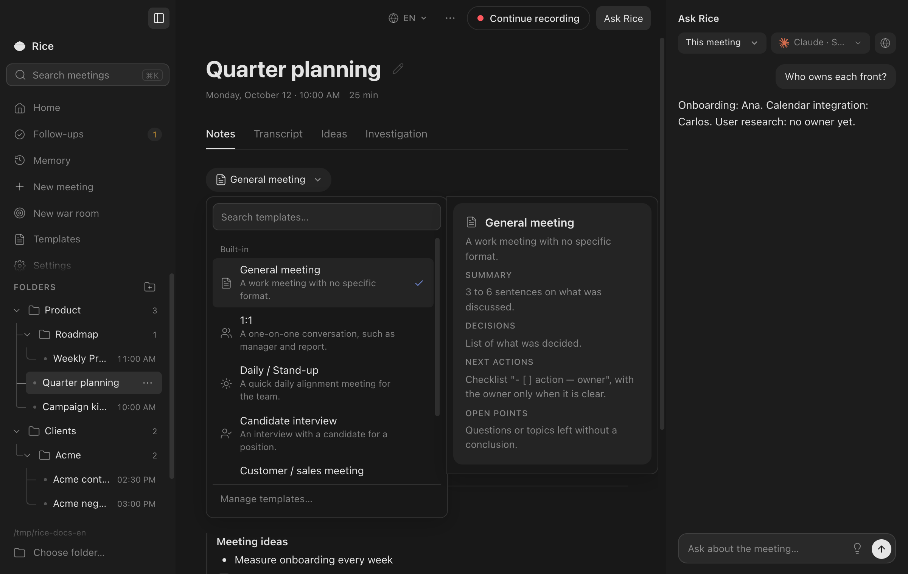

### Notes with your own jottings

What you type in **Annotations** during the meeting becomes a key point in the notes: Rice stores the time of each line, expands every note in the right section using the transcript, and highlights your text (what the AI added appears in a softer tone). Nothing you wrote is dropped: whatever fits no section goes to "Other notes".

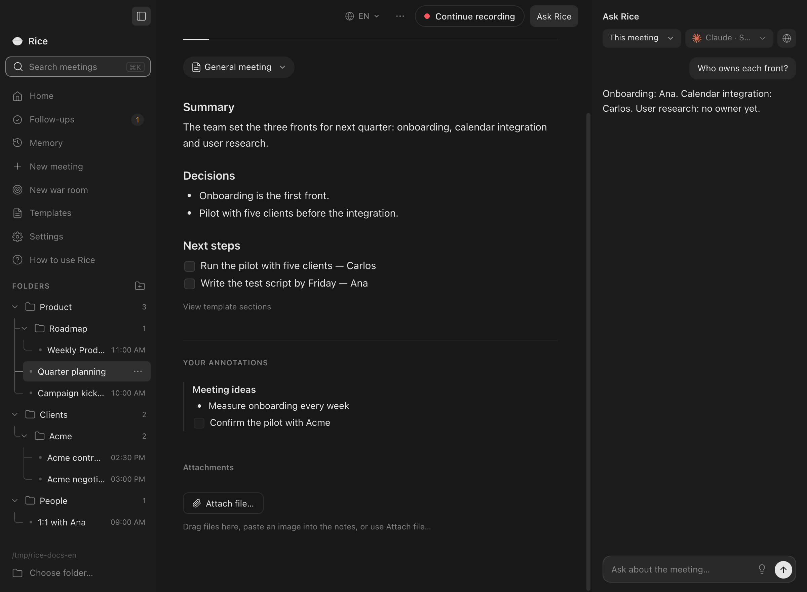

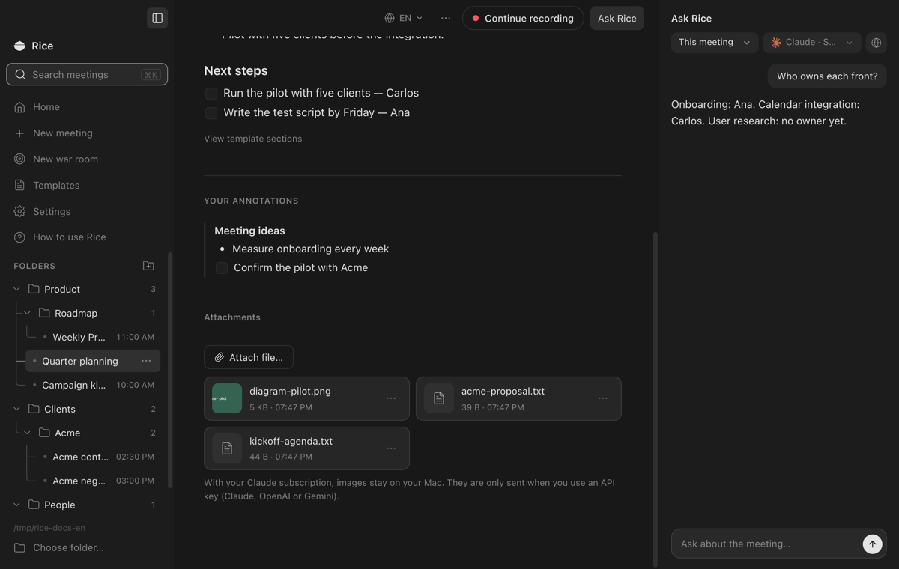

### Vocabulary

In **Settings › Vocabulary**, add names, clients and acronyms as chips: type one and press **Enter** (or a comma); **×** removes it, **Backspace** on the empty field removes the last one, and pasting several lines adds several chips (repeats are ignored). They help the transcript (they go in the whisper prompt) and the notes get the spelling right. Calendar event attendees are added automatically (you can turn this off).

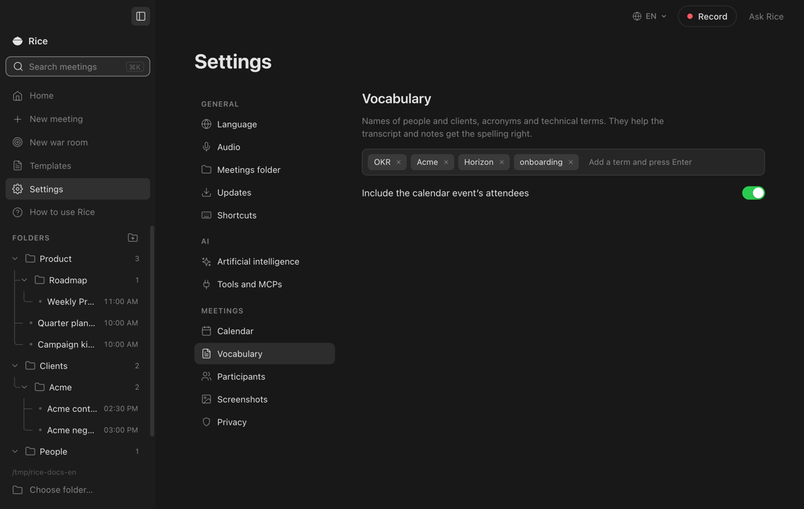

### Long meetings

Meetings of 1 to 2 hours are summarized in ~15-minute parts and then combined into the chosen template; you see "Generating notes… part 2 of 6". The meeting chat uses the per-part summary and the passages most relevant to your question.

### Identify participants (beta)

In **Settings › Participants**, Rice tells the voices on the computer audio apart as Person 1, Person 2… Click the label to name them (applies to the whole meeting; calendar attendees show up as shortcuts and the AI can suggest from context, always as a suggestion). Everything runs on your Mac: it downloads a 27 MB model the first time and uses about 100 MB of memory while recording. The names are used in the notes, the chat, the search and the exported PDF; the transcript file keeps "Person N".

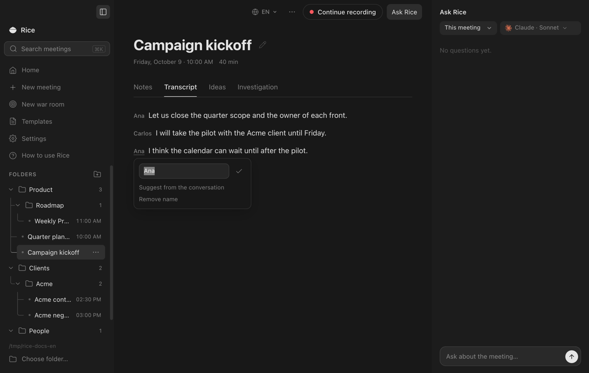

### Edit and create templates

Open **Templates** in the sidebar. Built-in templates can be edited (and restored later); **Duplicate** creates your own. A template is just a title, a short description and the list of sections Rice should fill in.

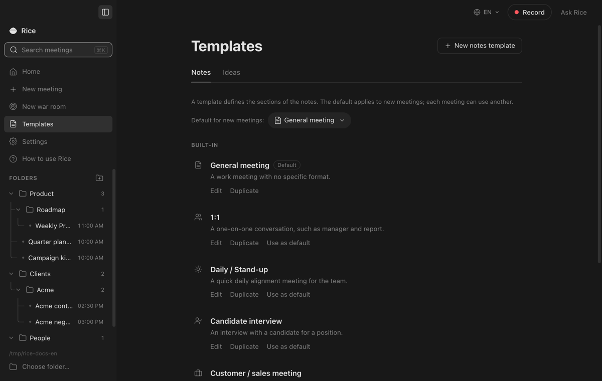
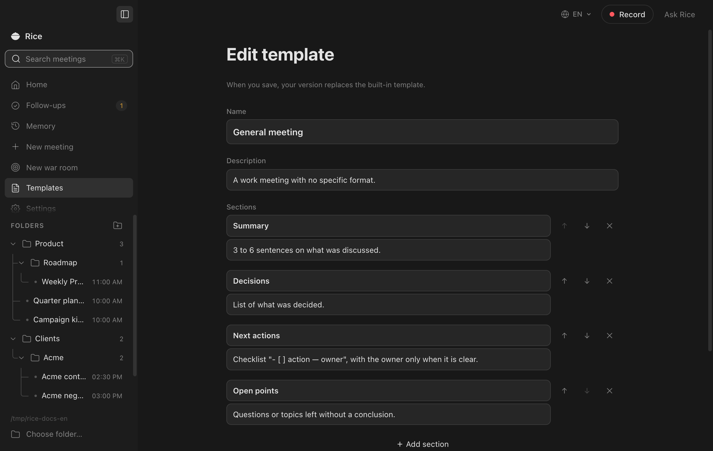

### Ask the AI

Click **Ask Rice** (top right) and ask anything about the open meeting: decisions, who does what, what was said about a topic. Questions and answers are saved in the meeting.


**Switching the AI and model in the chat.** In the chat header, the chip with the AI name (for example "Claude · Sonnet") opens a menu with the providers you have already set up and each one's models; the current one shows a ✓. The choice applies to the whole app (it is the same as Settings > AI): the next question and the next notes already use the chosen model. Providers not set up yet appear at the end, with "Set up…". The chip is disabled while an answer is being written. In OpenCode, the free model is an explicit option and warns that it may use your transcripts to improve models.

### Ask across your meetings

Open **Home** (first item of the sidebar): the **Ask about your meetings** field sits at the top of the page. You can also press **⌘J** from anywhere. Rice opens the chat panel in **All meetings** mode: it picks the most relevant meetings from your question (its words, a period such as "last month" or "last week", a folder or client name), sends their notes and the matching transcript passages to your AI and answers citing the meetings. The small numbers in the answer, and the **Sources** line, open the meeting at that passage.

The chip at the top of the panel switches between **This meeting**, **All meetings** and a single folder (with its subfolders). The conversation is saved in `.rice/chat-global.jsonl`; **New conversation** starts over.

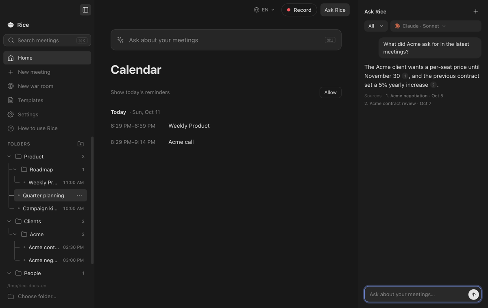

### Mini Rice

While recording, a small pill floats on your screen, so you can leave the Rice window. Move the mouse over it and **Ask** and **Stop** appear. Click the logo to bring Rice back, and drag the pill by the logo column to move it.

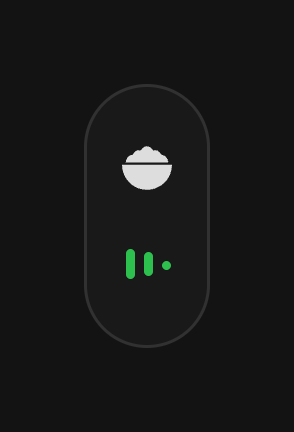
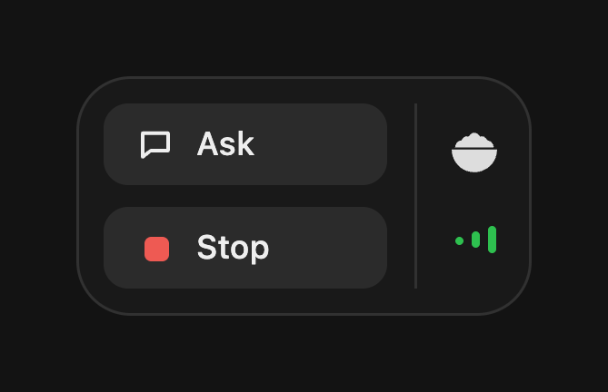

*These two images are the real Mini Rice window rendered on a neutral background, with the hover state forced.*

### Folders

Click the folder icon next to **Folders** in the sidebar to create one. Folders can hold other folders, up to 4 levels: use **⋯ › New subfolder**, or drag a folder onto another to move it inside (drop it on the top or bottom edge of a folder to reorder instead). Move a meeting with **⋯ › Move to folder**, where the list shows the tree, or drag it onto a folder. Thin guide lines connect each folder to what is inside it, the count includes the subfolders, and open or closed is remembered per folder.

Folders are only labels: the meeting stays where it is on disk. Deleting a folder deletes nothing: its subfolders and meetings move up to the parent folder.

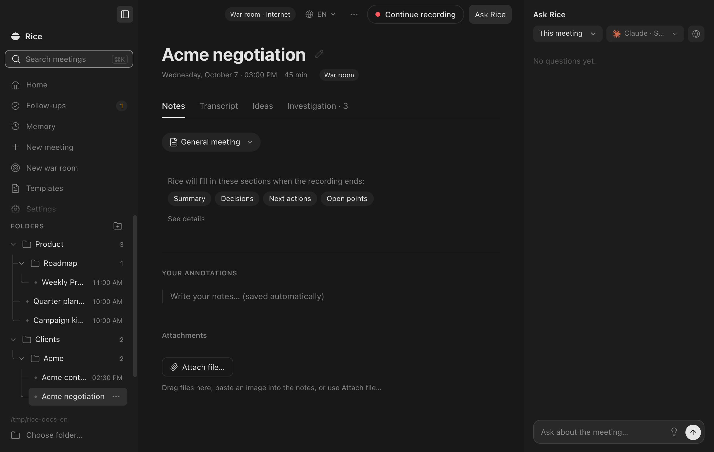

### Search

Press **⌘K** and type. Rice searches inside your meetings: titles, notes, annotations and transcripts, ignoring accents and capitals, and also folder names. Each result shows the date, a one-line snippet with your words in bold and where it was found (in notes, in transcript…). Use **↑ ↓** and **Enter** to move through the results, or click one: the meeting opens already scrolled to the passage, which flashes for a moment. **Esc** clears the search.

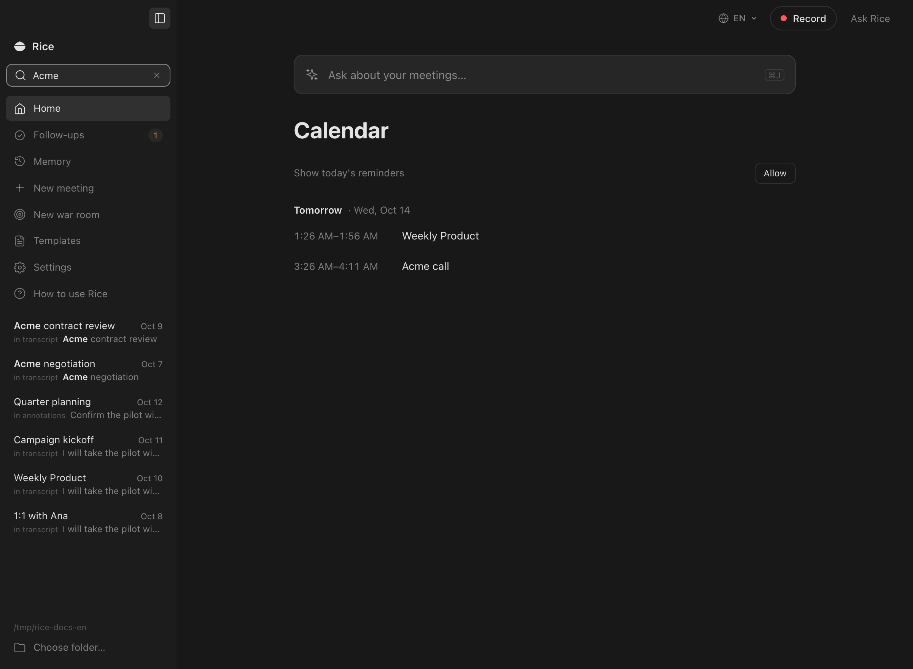

### Share

The **⋯** menu of a meeting has **Share**:

- **Copy notes** puts the notes on the clipboard formatted (headings, lists, to-dos) and as Markdown, so pasting into Slack, Gmail, Notion or Google Docs keeps the formatting. A small "Notes copied" appears.
- **Copy as Markdown** copies only the Markdown.
- **Follow-up email draft**: the AI writes a subject and a body (thanks, short summary, decisions, next steps with owners) in the language of the meeting. You edit it in a clean dialog and **Copy** it or **Open in Mail**. If the meeting came from a calendar event, the recipients are filled with the attendees, never with your own address. Drafts too long for a `mailto:` link only offer Copy.
- **Export PDF…** makes a clean page (title, date, participants, notes and, if you tick it, the transcript) and asks where to save it.

There is no Notion integration, so no extra credentials: use **Copy notes** and paste into Notion, which converts it by itself.

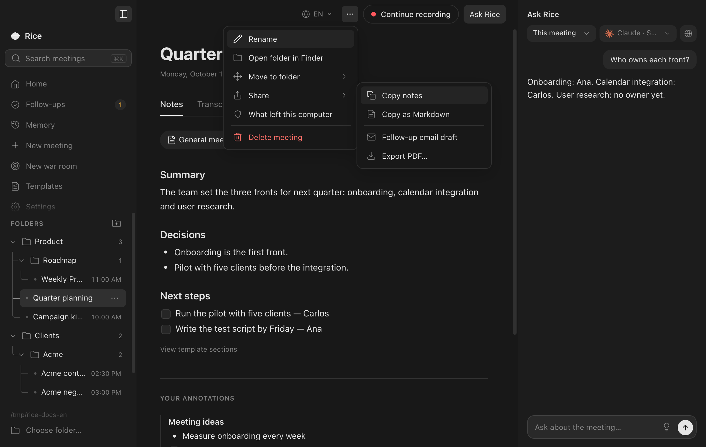
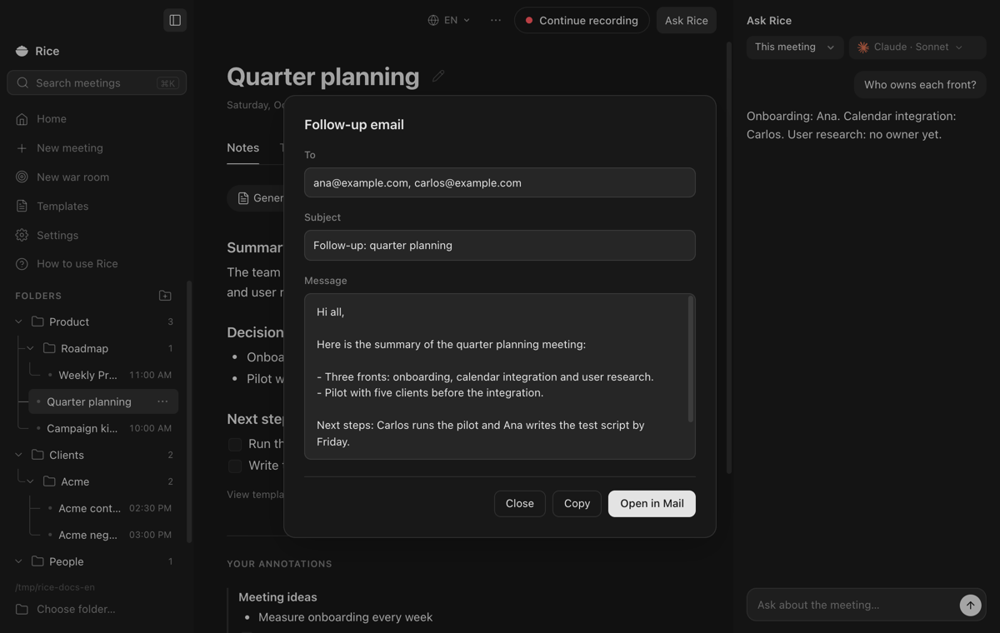

### Languages

The **globe chip** (PT/EN) at the top of every screen opens a small tree: **App language ▸** and **Meetings language ▸** (inside a meeting it has two sections, **This meeting** and **Default**). The same two choices are in **Settings › Language**:

- **App language**: the texts of Rice (Português or English).
- **Meetings language**: the language spoken in your meetings (Portuguese, English or Automatic). A fixed language gives the best quality. You can also change it for a single meeting with the chip at the top of the meeting. It cannot be changed while recording. Notes are written in the language of the meeting.

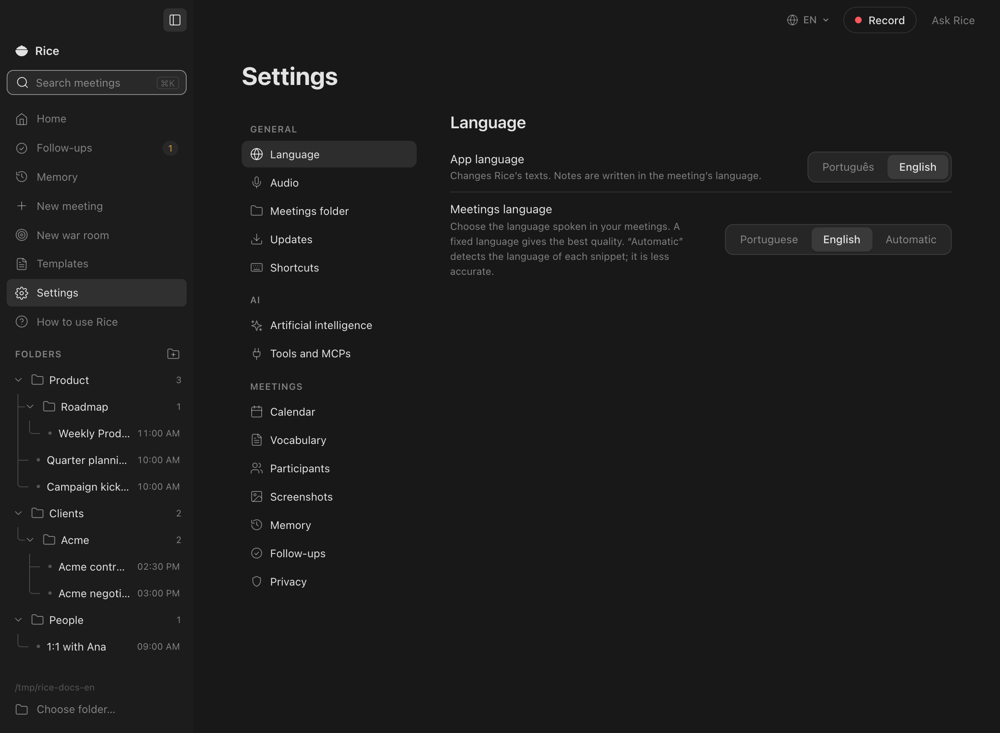

### Delete a meeting

**⋯ › Delete meeting** asks for confirmation, then moves the whole meeting folder to the **macOS Trash**, so you can recover it from there.

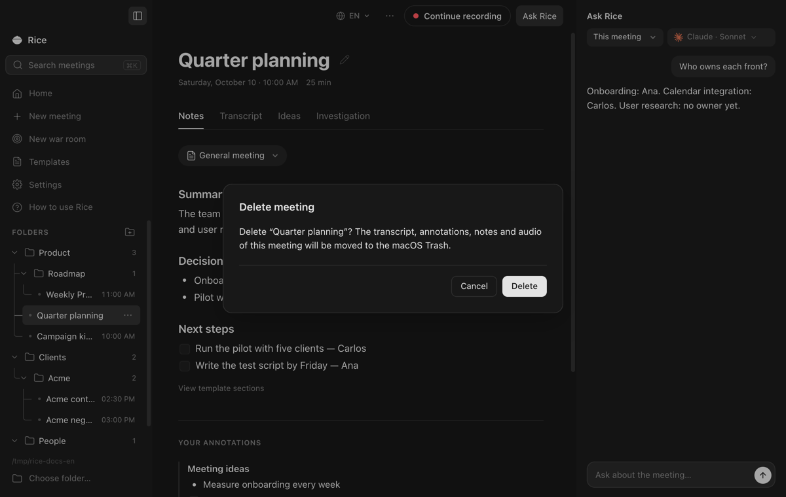

### Live ideas and War room
**Idea types.** On the Ideas tab, *Type: General ▾* chooses what the AI suggests: General (ideas, questions and risks), Brainstorm, Questions to ask now, Risks and objections, Sales, Interview or Technical. Each is an editable template (instruction + optional categories) and you can create your own in **Templates > Ideas** (stored in `.rice/idea-templates/`). The choice is per meeting (the last one chosen is the default for new ones), and switching mid-meeting applies from the next cycle.

**New war room** (sidebar or Home) creates a meeting already in War room mode and opens the Investigation tab; any meeting can be turned into one from that tab, and a small **War room** badge next to the date turns it back. The Ideas and Investigation tabs sit on the meeting page next to Notes and Transcript, each with a short explanation. While recording, the Ideas tab suggests 1 to 3 ideas, questions or risks every 2, 5, 10 or 15 minutes (your choice), only when there is new speech. Pin the good ones to your notes. In War room meetings, the Investigation tab runs cycles (with its own interval, independent of the ideas) and lists **Findings** as they arrive, newest first, each with its source (a clickable URL, or a file inside the work folder revealed in Finder) and time. **Pin** the ones that matter (they go to the top and always stay in the context of later cycles; the most recent ones follow) and **Dismiss** the rest (with a few seconds to **Undo**). The tab counter shows findings that are new since you last looked. *Stop* aborts the running cycle and *Investigation on* pauses the investigation without losing the sources. Optional sources, each with a warning and off by default: Internet (search and page reading), MCPs, and a read-only work folder. Works with Claude and Codex subscriptions. Notes and e-mails never use tools.

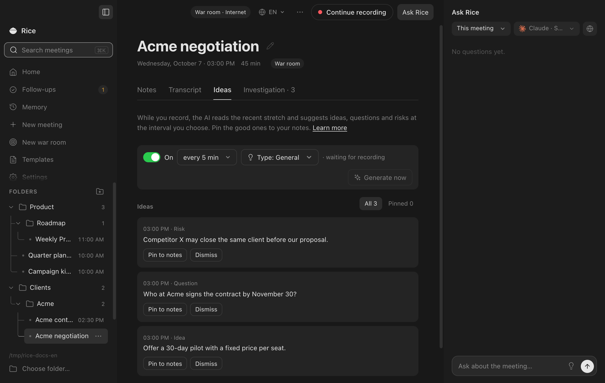

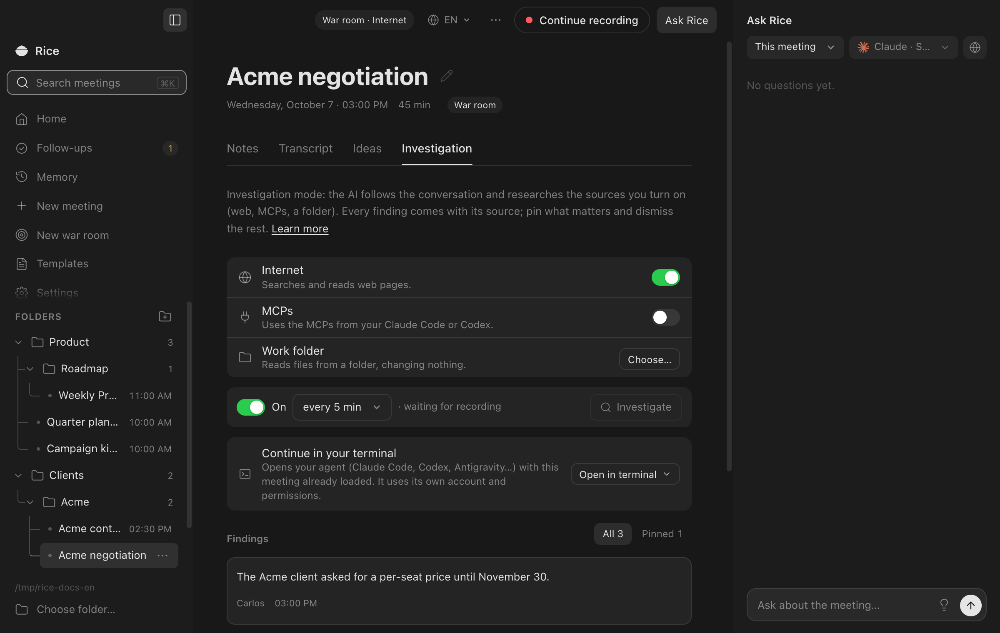

**Continue in your own Claude/Codex.** On the Investigation tab, *Continue in terminal* opens your own CLI (Claude Code, Codex, Gemini CLI, Antigravity or OpenCode — only the ones found on your Mac) in Terminal, in the work folder (you pick it first; home, `/` and credential folders are refused), with a prompt to follow the live `transcricao.md` and investigate. The prompt carries only file paths and the findings you confirmed, never the transcript itself. *Copy prompt* is there for any other harness or IDE. Rice keeps recording and updating the file; the other harness uses its own permissions and account, and Rice does not control what it does.

## Where your files live

Everything is in the meetings folder you chose (for example `~/Rice`):

```text
Rice/
├── .rice/
│   ├── folders.json            # your sidebar folders (and which one is inside which)
│   ├── chat-global.jsonl       # the chat across meetings
│   └── templates/              # your templates, one .json each
└── 2026-10-09 1000 - Quarterly planning/
    ├── meta.json               # title, time, language, template, folder…
    ├── transcricao.md          # the transcript
    ├── anotacoes.md            # what you wrote in "Annotations"
    ├── anotacoes.json          # the time of each line you typed during the recording
    ├── falantes.json           # which voice is which person (if "Identify participants" is on)
    ├── extracoes.json          # per-part summaries of long meetings
    ├── notas.md                # the notes written by the AI
    ├── notas-versoes/          # earlier versions of the notes (up to 20) + index.json
    ├── chat.md                 # the chat, readable
    ├── chat.jsonl              # the chat, for the app
    └── audio.m4a               # the audio (if "Keep meeting audio" is on)
```

The file names are in Portuguese for now. App settings, secrets and the transcription model are in `~/Library/Application Support/Rice`.

## Keyboard shortcuts

| Shortcut | Action |
| --- | --- |
| **⌘K** | Focus the search box |
| **⌘J** | Ask across all your meetings |
| **↑ ↓ Enter** (in search) | Move through the results and open one |
| **Esc** | Clear the search / close a menu or dialog |
| **⌘⌫** | Delete the open meeting (asks first) |
| **⌘,** | Open Settings |
| **↑ ↓ → ← Enter** | Move through menus and submenus |

## Troubleshooting

**Disk full or folder unavailable.** Rice warns before recording if less than 1 GB is free. If the disk fills up during a meeting, a red alert appears, audio stops being saved and the transcript keeps being stored (in memory and in a local copy) until there is space. If the meetings folder disappears (ejected volume, deleted folder), Rice recreates it or saves to a safe place and tells you where. Free up space or reconnect the volume: the alert goes away by itself and the stretch without audio is marked in the transcript.

**Rice closed in the middle of a recording.** When you open it again, the meeting shows as "Recording interrupted". Open it and click "Recover meeting": Rice finishes the audio, transcribes what had no text yet and generates the notes. You can also click "Continue recording".

**The Mac went to sleep during the meeting.** Recording continues in the same meeting; the sleeping stretch appears as "recording paused from … to …" and system audio is reconnected.

**"Possible audio drop" or "the microphone lost its permission".** Rice tries to reconnect by itself a few times. If it does not come back, use "Open permissions" in the alert and enable the microphone (or system audio capture) for Rice in System Settings > Privacy & Security.

**"Still recording?"** After 15 minutes without speech Rice asks; with no answer in 2 minutes it stops the recording and offers "Resume". In `settings.json`, `inactivityMinutes` changes the time (0 turns it off). Recordings longer than 3 hours get a reminder every hour.

**Notes that do not come out.** If the app closed during generation, the meeting shows "Generate notes". Network failures get one automatic retry; login or usage-limit errors need your action (the message says which).

**"Needs repair".** If a meeting's `meta.json` is unreadable, it stays in the list with that badge; "Repair meeting" rebuilds title, date and state from the folder name and keeps the bad file as `meta.json.corrompido`.

**No system audio (only my voice is transcribed).**
Allow *System audio recording* for Rice (or Electron) in System Settings › Privacy & Security, then quit and reopen the app. Use headphones to avoid echo.

**The AI does not connect.**
Open **Test connection** for that provider. For subscriptions the login may have expired: run `claude setup-token` again (and paste the new token), or `codex login`. For API keys, check that the key is active and has credit.

**Transcription is slow or the Mac gets hot.**
Close heavy apps while recording. The default quantized model is the lightest one; make sure you did not set `RICE_WHISPER_MODEL=f16`.

**`npm run app` says Electron failed to install.**
Run `node node_modules/electron/install.js`.

**`scripts/build-native.sh` fails.**
Check that `xcode-select -p` prints a path and that `brew install meson ninja pkg-config` finished. The first build also needs internet.

**Rice says `whisper-server` is missing.**
Run `brew install whisper.cpp`, or point `RICE_WHISPER_SERVER` to the binary.

**Update.**
```bash
cd rice
git pull
npm install
scripts/build-native.sh
npm run app
```

### Tools and MCPs (advanced, at your own risk)
In Settings > Tools and MCPs in chat you can let the chat use the MCPs you already set up in Claude Code (`claude mcp add …`) or Codex, e.g. to create Notion or ClickUp tasks from a meeting. Off by default and chat only; never notes, e-mails or extractions. Note: meeting text comes from third parties and may carry malicious instructions; tool actions may be irreversible. Each use shows as "Tool used: server · tool". Claude and Codex subscriptions only.

## Privacy

- Audio is recorded and transcribed on your Mac and never leaves it.
- Only text leaves your Mac: the transcript and your questions go to the AI provider **you** chose, and only when Rice writes notes or answers. Rice has no servers, account, telemetry or error reporting. The code is open (MIT).
- Questions across meetings and follow-up drafts send, to the provider **you** chose, only the notes and a few transcript passages of the meetings they need (at most 8, with a size limit). Search runs entirely on your Mac.
- Everything Rice creates (audio, transcripts, notes, chats, settings) lives in folders and files only your user can read (permissions 0700/0600). Keys and tokens are kept in the macOS Keychain.
- The AI CLIs run without tools that touch your files (Claude with no tools; Codex with shell, browser, computer and plugins turned off; OpenCode with every permission denied; Antigravity inside a macOS sandbox that only allows writing to an empty temporary folder, blocks commands and blocks reading your home folder). OpenCode Zen's free model may use your transcripts to improve models.
- The transcription and voice models are downloaded once and checked by SHA-256. Google Calendar (optional) is read-only; you can use the macOS Calendar instead.
- The app only loads its own local pages: it does not navigate to websites, open windows or request page permissions.
- Deleting a meeting moves it to the Trash; nothing is kept elsewhere.
- Recording laws vary: in many places you must tell participants the meeting is being recorded.

## License

MIT — see [LICENSE](LICENSE).
