<p align="center">
  
</p>

<h1 align="center">Rice</h1>

<p align="center"><a href="README.md">English</a> · <b>Português</b></p>

O Rice é um app para Mac que grava suas reuniões, transcreve no seu computador e escreve as notas para você.

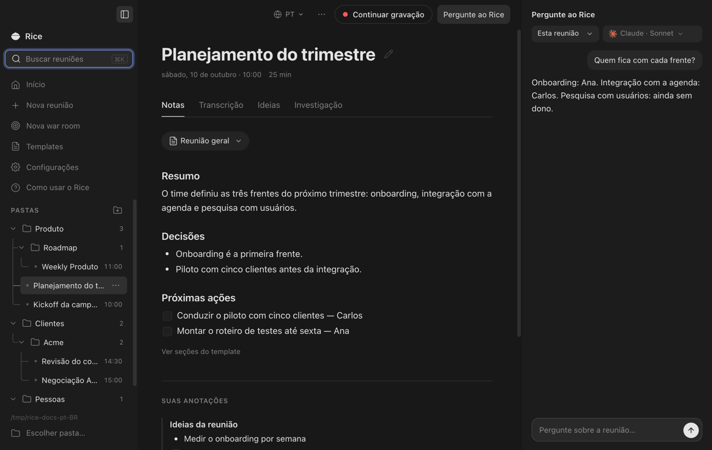

- **Transcrição local.** Grava o microfone e o áudio do sistema (os outros participantes) e transcreve com o [whisper.cpp](https://github.com/ggml-org/whisper.cpp). O áudio não sai do seu Mac.
- **Notas escritas por uma IA, a partir de templates.** Quando a gravação termina, o Rice preenche as seções de um template (Resumo, Decisões, Próximas ações…). Você escolhe a IA: Claude, ChatGPT, Gemini ou OpenCode.
- **Pergunte sobre a reunião.** Um painel de chat responde sobre o que foi dito.
- **Pastas.** Agrupe as reuniões na barra lateral, como pastas de um app de notas.
- **Busque em tudo.** Encontre uma palavra nos títulos, notas, anotações e transcrições de todas as reuniões.
- **Pergunte entre reuniões.** Uma pergunta, respondida com as notas das reuniões certas, com links para elas.
- **Compartilhe.** Copie as notas formatadas, gere um rascunho de e-mail de follow-up ou exporte um PDF.
- **Mini Rice.** Uma pílula flutuante mostra que você está gravando, com **Perguntar** e **Parar** a um passar de mouse.

## Sumário

- [Requisitos](#requisitos)
- [Instalação](#instalação)
- [Primeiros passos](#primeiros-passos)
- [Conectar uma IA](#conectar-uma-ia)
- [Uso no dia a dia](#uso-no-dia-a-dia)
- [Onde ficam os arquivos](#onde-ficam-os-arquivos)
- [Atalhos de teclado](#atalhos-de-teclado)
- [Solução de problemas](#solução-de-problemas)
- [Privacidade](#privacidade)
- [Licença](#licença)

## Requisitos

- Um Mac com **Apple Silicon** (M1 ou mais novo). Macs Intel ainda não são suportados.
- **macOS 14 (Sonoma) ou mais novo**. O Rice usa a captura de áudio do sistema que chegou nessa versão.
- **Xcode Command Line Tools** (`xcode-select --install`), para compilar os pequenos programas nativos de áudio.
- [**Homebrew**](https://brew.sh), usado para instalar o `whisper.cpp` e as ferramentas de build.
- **Node.js 22** ou mais novo.
- Cerca de **0,6 GB** livres em disco para o modelo de transcrição (baixado na primeira vez).
- Uma conta ou chave de API de pelo menos um provedor de IA (veja [Conectar uma IA](#conectar-uma-ia)). A transcrição funciona sem; notas e chat precisam dela.

## Instalação

Precisa de um Mac com Apple Silicon (arm64) e macOS 14 ou mais novo. A transcrição usa o `whisper-server` do Homebrew (`brew install whisper.cpp`).

### Opção 1 — para devs: compilar e instalar a partir do código

```bash
git clone https://github.com/WalissonCF/rice.git
cd rice
./install.sh
```

O `install.sh` confere macOS/arm64, as Ferramentas de Linha de Comando do Xcode, o Homebrew e o Node 22+, instala o que falta com o Homebrew (`whisper.cpp meson ninja pkg-config`), roda `npm ci` e `npm run dist`, copia o **Rice.app** para `/Applications` (substituindo o anterior) e remove a quarentena. Pode rodar de novo sem problema, para com uma mensagem clara (em português e inglês) quando falta algo e não usa `sudo` (só o Homebrew pode pedir). `./install.sh --check` só confere o ambiente.

### Opção 2 — baixar o .dmg

Baixe o `Rice-<versão>-arm64.dmg` na página de **Releases**, abra e arraste o **Rice** para **Aplicativos**.

O Rice tem assinatura ad hoc e **não** é assinado nem notarizado pela Apple; por isso o Gatekeeper do macOS avisa na primeira abertura. Para abrir mesmo assim, clique com o botão direito em **Rice** na pasta Aplicativos e escolha **Abrir** (e **Abrir** de novo), ou rode:

```bash
xattr -dr com.apple.quarantine /Applications/Rice.app
```

Como não é assinado pela Apple, o macOS pode pedir de novo as permissões (microfone, áudio do sistema, Calendário) depois de uma atualização.

Você ainda precisa do `brew install whisper.cpp` para o servidor de transcrição; o modelo de transcrição em si é baixado na primeira abertura.

### Rodar a partir do código (desenvolvimento)

```bash
brew install whisper.cpp meson ninja pkg-config
npm install
node node_modules/electron/install.js   # baixa o Electron (a "casca" do app)
scripts/build-native.sh                 # programas nativos de áudio (precisa de internet na primeira vez)
npm run app                             # compile e abra o Rice
```

Bom saber:

- O `scripts/build-native.sh` compila primeiro o cancelador de eco (WebRTC audio processing, baixado e conferido com um SHA-256 fixo) e depois os dois programas em Swift. As próximas execuções são rápidas.
- O servidor de transcrição é o `whisper-server` do Homebrew. O Rice espera encontrá-lo em `/opt/homebrew/bin/whisper-server`. Se o seu estiver em outro lugar, abra o Rice com `RICE_WHISPER_SERVER=/caminho/whisper-server npm run app`.
- O modelo de transcrição é baixado sozinho na primeira abertura para `~/Library/Application Support/Rice/models` e conferido com SHA-256. Por padrão o Rice usa o `large-v3-turbo` quantizado (cerca de 0,6 GB). `RICE_WHISPER_MODEL=f16` troca para o modelo completo (cerca de 1,6 GB).
- Para abrir o Rice depois, abra o **Rice** em Aplicativos (instalado pelo .dmg ou pelo `install.sh`) ou, rodando do código, `npm run app` dentro da pasta `rice`.

**Dock e Aplicativos.** Ainda não existe um `.app` empacotado. Enquanto o Rice está aberto, você pode mantê-lo no Dock com clique direito no ícone › Opções › Manter no Dock. *Em breve: um `.dmg` e um cask do Homebrew.*

## Primeiros passos

Abra **Como usar o Rice** na barra lateral. É uma lista de passos que se atualiza ao vivo.

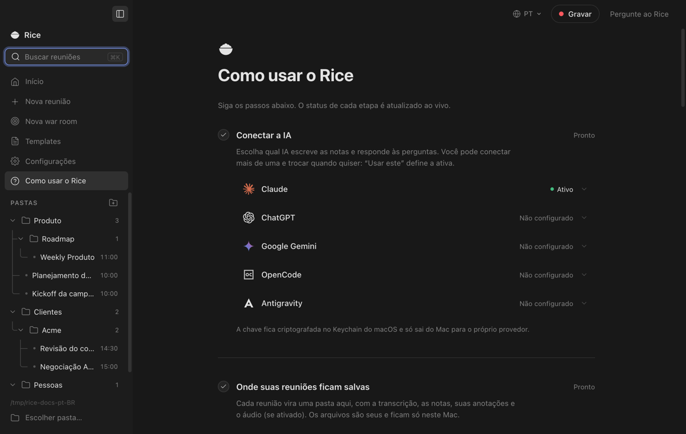

### 1. Escolha onde salvar as reuniões

Cada reunião vira uma pasta com a transcrição, as notas e o chat. Escolha o lugar em **Configurações › Pasta das reuniões** ou no guia (**Trocar pasta…**). Os arquivos são Markdown simples, então qualquer app abre.

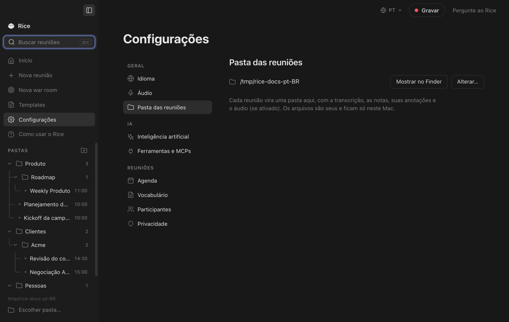

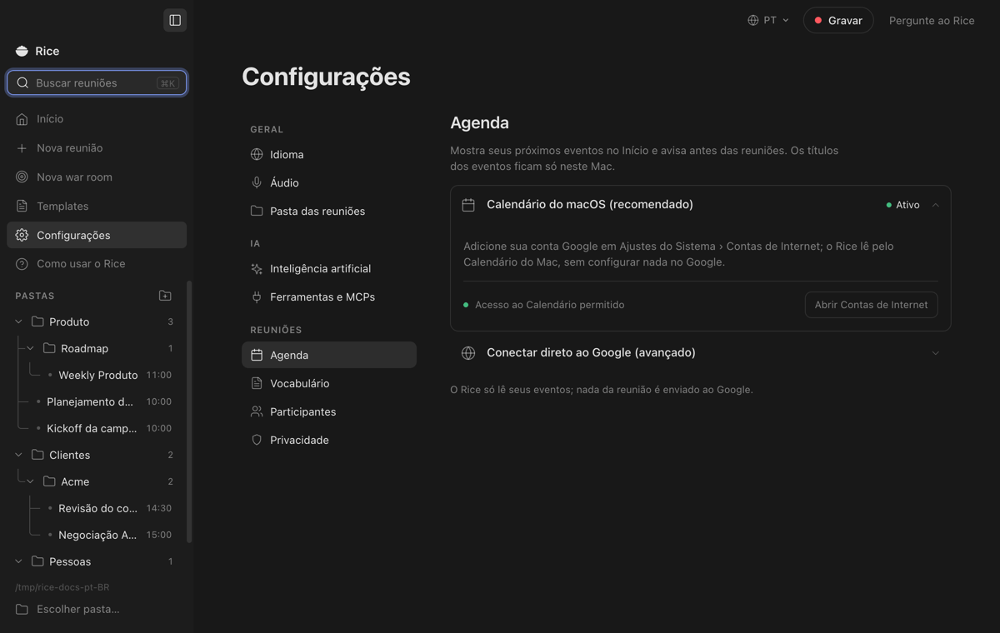

### 2. Libere as permissões do macOS

Na primeira gravação o macOS pede duas coisas:

| Permissão | Para quê | Onde liberar |
| --- | --- | --- |
| **Microfone** | Para o Rice ouvir você. | Ajustes do Sistema › Privacidade e Segurança › Microfone |
| **Gravação de áudio do sistema** | Para o Rice ouvir os outros participantes. | Ajustes do Sistema › Privacidade e Segurança › Gravação de Tela e Áudio do Sistema |

O guia tem o botão **Abrir Ajustes de Privacidade**. Ative o **Rice** (rodando pelo código ele pode aparecer como **Electron**) e reabra o app se o macOS pedir.

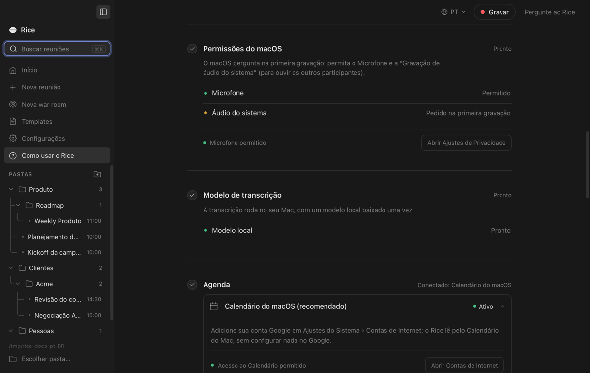

### 3. Deixe o modelo baixar

O guia mostra o progresso do modelo de transcrição. Quando aparecer **Modelo carregado**, já dá para gravar.

## Conectar uma IA

Abra **Configurações › Inteligência artificial** (a mesma lista aparece no guia **Como usar o Rice**). Cada provedor é uma linha, com a IA ativa no topo; clique numa linha para abrir os passos dela. Dá para conectar mais de um provedor e trocar quando quiser com **Usar este**.

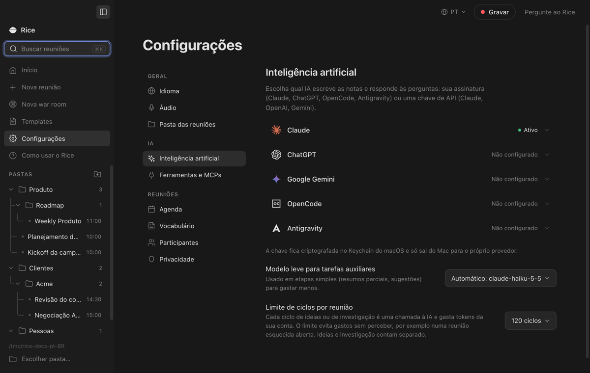

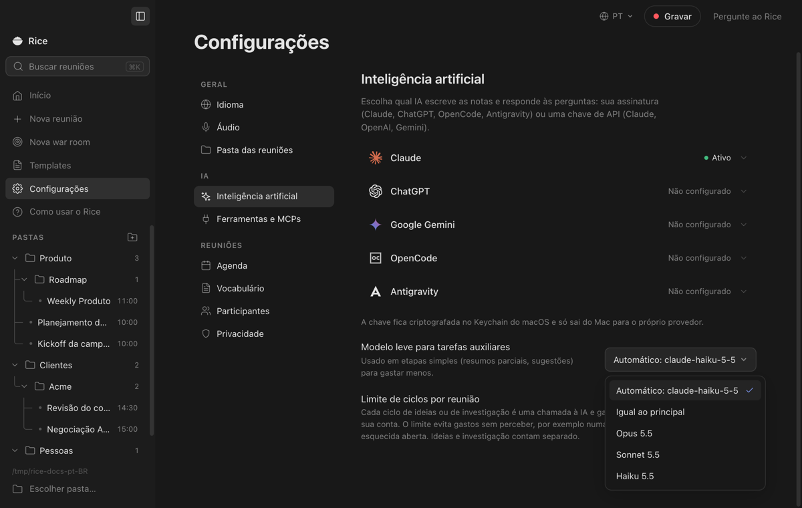

| Provedor | Opção | O que você precisa |
| --- | --- | --- |
| Claude | Assinatura | Rode `claude setup-token` no Terminal, entre pelo navegador e cole o token (começa com `sk-ant-oat`). |
| Claude | Chave de API | Crie uma chave em [console.anthropic.com](https://console.anthropic.com) › API Keys (começa com `sk-ant-api`). |
| ChatGPT | Assinatura | Instale o Codex CLI (`npm i -g @openai/codex` ou `brew install codex`), rode `codex login` e entre com sua conta do ChatGPT. Não há nada para colar. |
| ChatGPT | Chave de API | Crie uma chave em [platform.openai.com](https://platform.openai.com) › API keys (começa com `sk-`). |
| Gemini | Chave de API | Crie uma chave em [aistudio.google.com](https://aistudio.google.com) › Get API key (começa com `AIza`). O Google descontinuou o login do Gemini pelo terminal (CLI) para contas pessoais em junho de 2026, então o Gemini fica só com chave de API; quem usava por login é migrado para uma chave (ou outra IA já verificada) e recebe um aviso uma vez. |
| OpenCode | Login | Instale a CLI do [OpenCode](https://opencode.ai), rode `opencode auth login` e escolha sua assinatura. Nada para colar. Veja abaixo. |
| Antigravity | Login | Instale a CLI do Antigravity (`agy`) e rode `agy` no Terminal para entrar com sua conta. Nada para colar. Veja abaixo. |

Depois clique em **Testar conexão**.

- Chaves e tokens ficam criptografados no **Keychain do macOS** (`safeStorage` do Electron). Nunca são mostrados de novo e nunca são enviados a ninguém, a não ser ao provedor que você escolheu.
- O uso da API é cobrado pelo provedor, à parte de qualquer assinatura.

### OpenCode

O Rice usa a CLI do OpenCode já logada no seu Mac, igual ao Claude e ao ChatGPT. Instale com `curl -fsSL https://opencode.ai/install | bash` e rode `opencode auth login` no Terminal, escolhendo o provedor da sua assinatura (Claude Pro/Max, ChatGPT Plus/Pro, GitHub Copilot, OpenCode Zen…). Depois, no Rice, abra Conectar a IA > OpenCode, escolha o modelo (a lista mostra só os provedores em que você fez login) e clique em Testar conexão. O OpenCode roda só para gerar texto: com todas as permissões negadas (sem editar arquivos, rodar comandos, acessar a web, MCP ou plugins), numa pasta vazia, e sem herdar chaves de outros provedores. O modo Automático só usa modelos em que você fez login; sem nenhum, o Rice pede o login. O modelo gratuito (OpenCode Zen) só é usado se você o escolher na lista, e ele pode usar suas transcrições para melhorar modelos, então prefira sua assinatura para reuniões sensíveis.

### Antigravity (agy)

Você pode usar a assinatura do Antigravity como IA (Configurações > Inteligência artificial > Antigravity). Como o `agy` é um agente com acesso a arquivos e terminal, o Rice o roda dentro de um sandbox do macOS: ele só gera texto, não consegue gravar em lugar nenhum além de uma pasta temporária vazia, não executa comandos e não lê a sua pasta pessoal. A conversa criada a cada uso é apagada do estado do agy. O prompt entra pelo stdin, então não aparece na lista de processos. No Rice, clique em Testar conexão e escolha um modelo (a lista vem de `agy models`; no modo Automático o modelo leve das etapas simples é o menor Flash). O agente ainda tem acesso à web, por isso o Antigravity não fica disponível no War room nem no chat com ferramentas. As respostas demoram alguns segundos a mais que os outros provedores (o agy leva ~4 s para iniciar).

## Uso no dia a dia

### Gravar, parar e continuar

Clique em **Nova reunião** e depois em **Gravar**. Ao parar, o Rice escreve as notas. Se a reunião não acabou, abra-a depois e clique em **Continuar gravação**: o novo áudio e a transcrição entram na mesma reunião.

O Rice também percebe reuniões (Zoom, Meet, Teams) e eventos da agenda e sugere gravar.

### Versões das notas

Gerar as notas de novo (outro template ou transcrição nova) não perde mais as anteriores: as notas antigas ficam em `notas-versoes/` (até 20; as mais antigas saem primeiro). Um chip discreto **Versões (3)** ao lado do chip do template lista todas ("Brainstorm · hoje 16:40 · atual"); escolher uma mostra a versão em leitura, com uma faixa fina (**Voltar para a atual** / **Restaurar esta**). Busca, chat, copiar e PDF usam sempre a atual.

### Agenda

O **Início** mostra os próximos 7 dias agrupados por dia (Hoje, Amanhã, "sex., 17 de out."). Eventos de dia inteiro ficam numa linha discreta por dia; os com horário mostram o intervalo ("09:00–09:30") e **Entrar** / **Fazer notas** só quando são reuniões (link de chamada ou participantes). Conecte o **Calendário do macOS** (recomendado: adicione sua conta Google em Ajustes do Sistema › Contas de Internet) ou o Google direto em **Configurações › Agenda**. Os títulos dos eventos ficam no seu Mac: só o título da reunião que você grava é usado, e eventos de dia inteiro nunca geram convite de gravação.

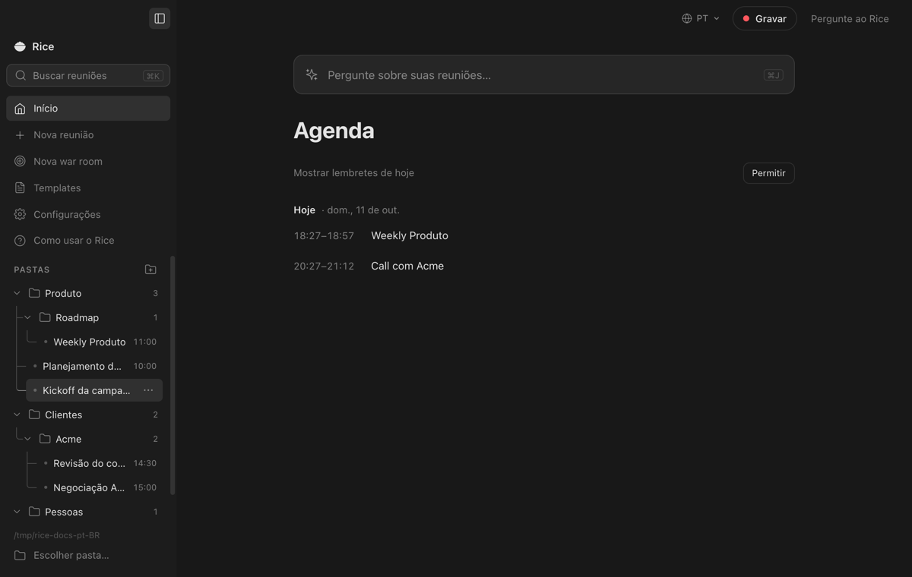

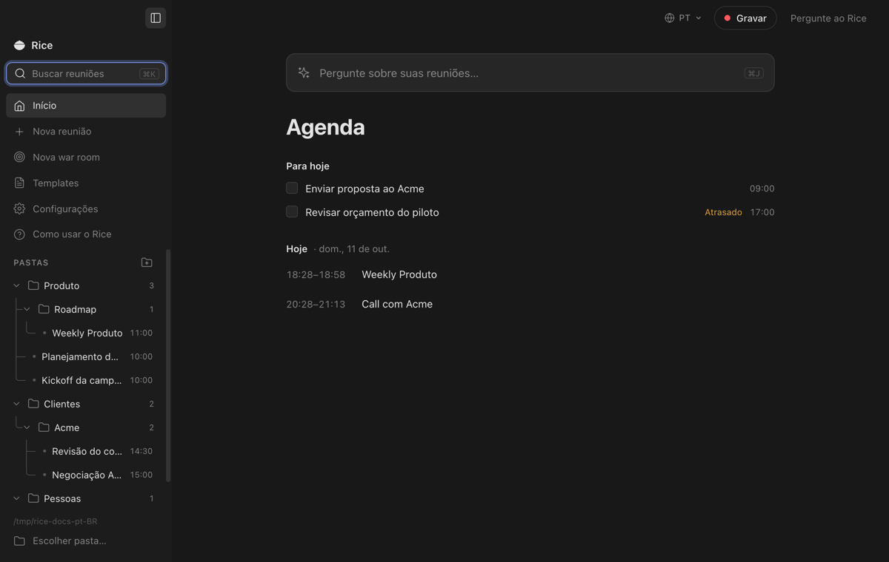

### Transcrição ao vivo

A transcrição aparece enquanto você fala. O texto cinza ainda está sendo refinado e vira definitivo em instantes. Sua voz aparece como **Eu** e os outros participantes como **Outros** (com o app em inglês, aparecem como *Me* e *Others*; no arquivo da transcrição ficam sempre `Eu` e `Outros`). Você pode escrever suas próprias notas em **Anotações** a qualquer momento.

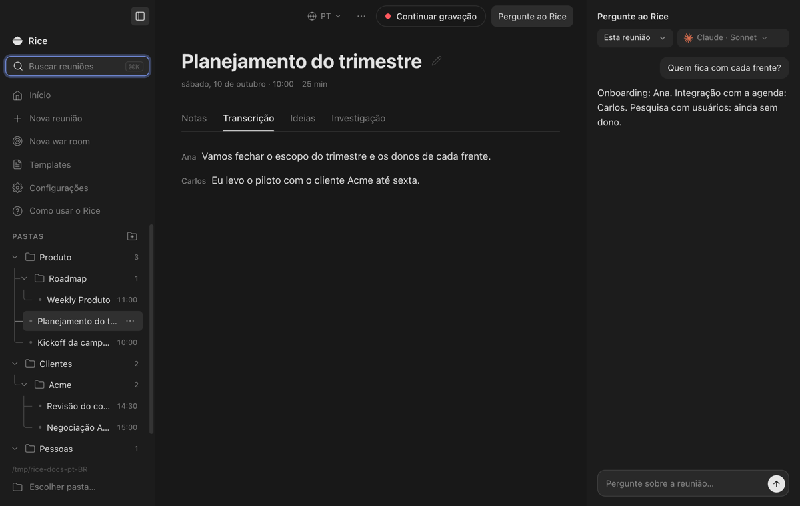

### Gerar notas e trocar o template

As notas são escritas assim que você para. Se faltarem ou falharem (por exemplo, ainda sem IA conectada), aparece o botão **Gerar notas**. O seletor acima das notas (por exemplo **Reunião geral**) troca o template, e o lado direito mostra as seções dele.

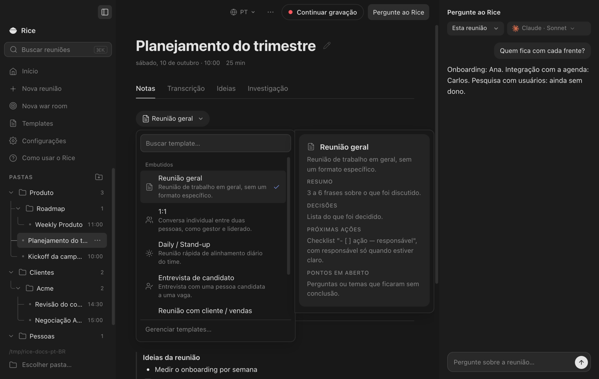

### Notas com as suas anotações

O que você digita em **Anotações** durante a reunião vira ponto importante nas notas: o Rice guarda o horário de cada linha, expande cada anotação na seção certa com o contexto da transcrição e destaca o seu texto (o que a IA acrescentou aparece num tom mais claro). Nada do que você escreveu é descartado: o que não couber vai para "Outros pontos".

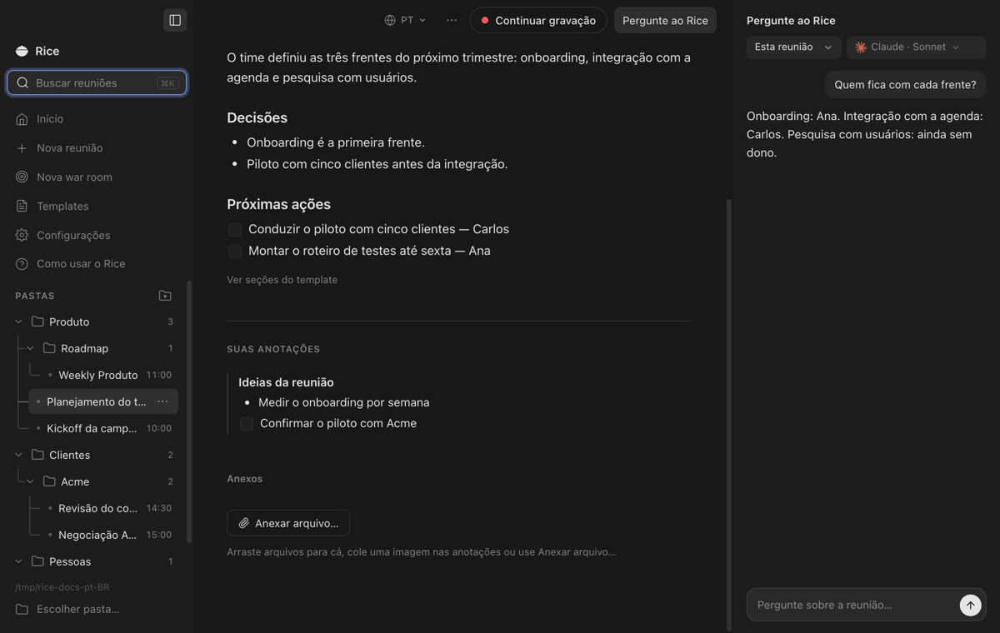

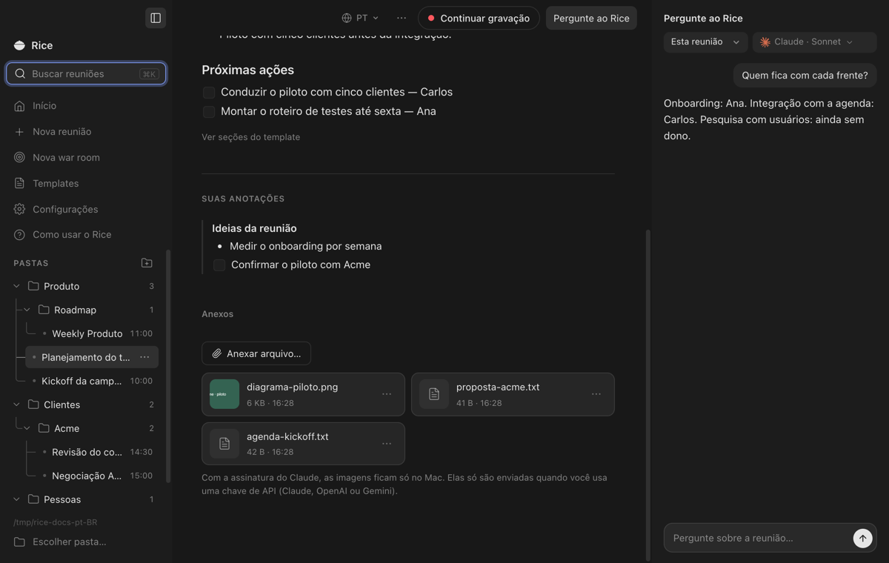

### Vocabulário

Em **Configurações › Vocabulário**, adicione nomes, clientes e siglas como chips: digite um e aperte **Enter** (ou vírgula); o **×** remove, **Backspace** no campo vazio remove o último, e colar várias linhas cria vários chips (repetidos são ignorados). Eles ajudam a transcrição (vão no prompt do whisper) e as notas a acertar a grafia. Os participantes do evento da agenda entram automaticamente (dá para desligar).

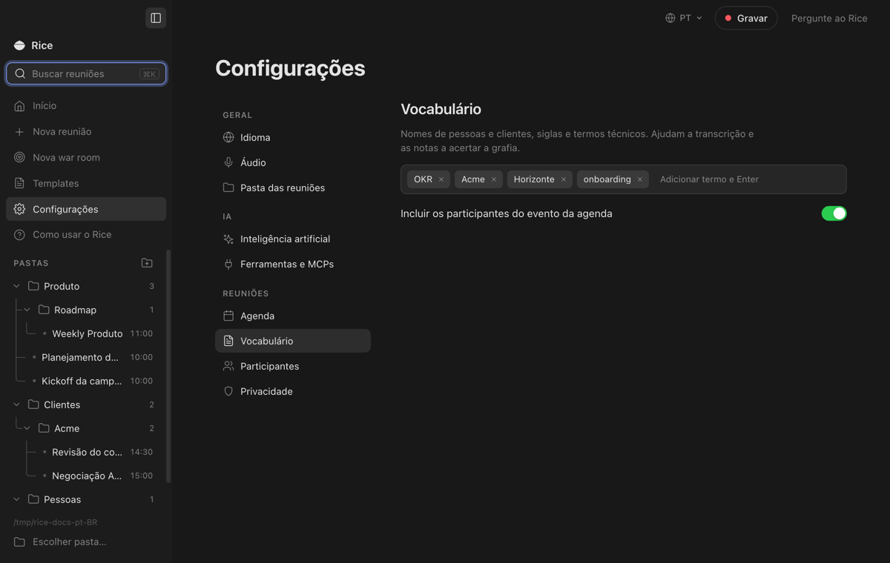

### Reuniões longas

Reuniões de 1 a 2 horas são resumidas por partes de ~15 minutos e depois combinadas no template escolhido; você vê "Gerando notas… parte 2 de 6". O chat da reunião usa o resumo por partes e os trechos mais relevantes para a sua pergunta.

### Identificar participantes (beta)

Em **Configurações › Participantes**, o Rice separa as vozes do áudio do computador em Pessoa 1, Pessoa 2… Clique no rótulo para dar um nome (vale para a reunião toda; os participantes da agenda aparecem como atalho, e a IA pode sugerir pelo contexto, sempre como sugestão). Tudo roda no seu Mac: baixa um modelo de 27 MB na primeira vez e usa cerca de 100 MB de memória enquanto grava. Os nomes valem nas notas, no chat, na busca e no PDF exportado; o arquivo da transcrição continua com "Pessoa N".

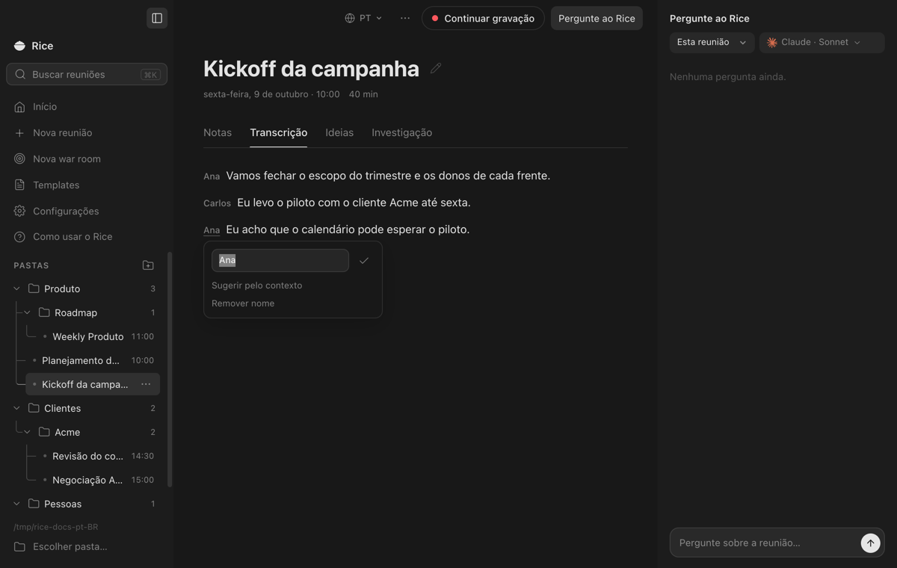

### Editar e criar templates

Abra **Templates** na barra lateral. Os templates embutidos podem ser editados (e restaurados depois); **Duplicar** cria o seu. Um template é só um título, uma descrição curta e a lista de seções que o Rice deve preencher.

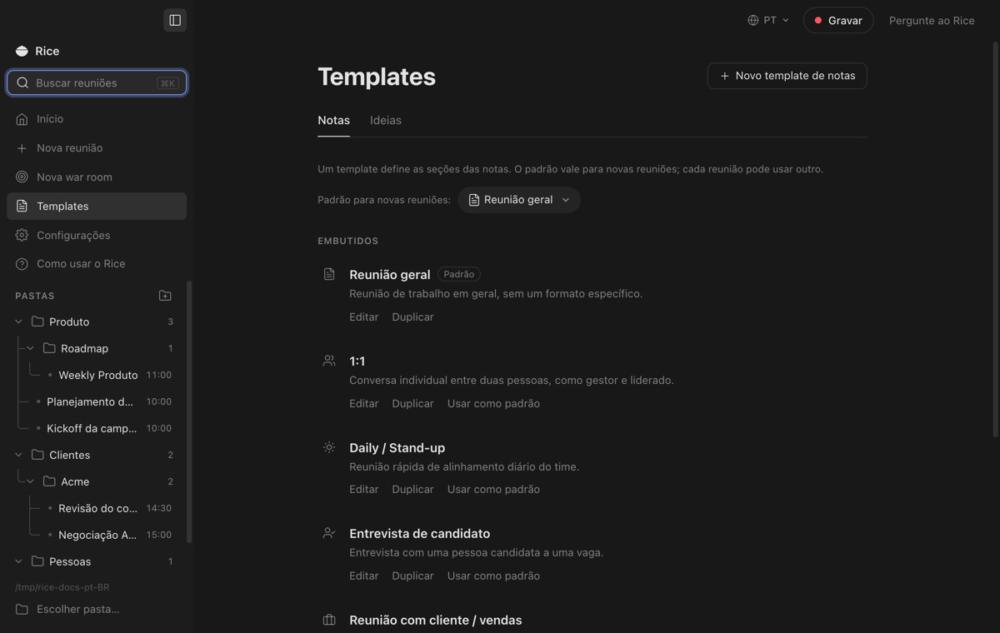
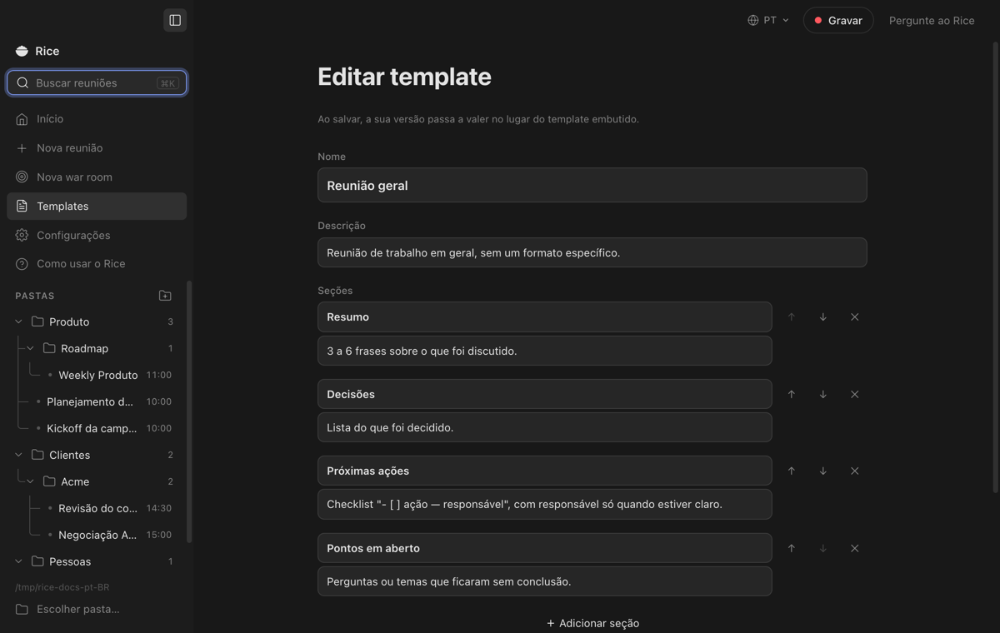

### Perguntar à IA

Clique em **Pergunte ao Rice** (canto superior direito) e pergunte qualquer coisa sobre a reunião aberta: decisões, quem faz o quê, o que se falou sobre um assunto. Perguntas e respostas ficam salvas na reunião.


**Trocar a IA e o modelo no chat.** No cabeçalho do chat, o chip com o nome da IA (por exemplo "Claude · Sonnet") abre um menu com os provedores que você já configurou e os modelos de cada um; o atual aparece com ✓. A escolha vale para o app inteiro (é a mesma de Configurações > IA): a próxima pergunta e as próximas notas já usam o modelo escolhido. Provedores ainda não configurados aparecem no fim, com "Configurar…". Durante uma resposta o chip fica desabilitado. No OpenCode, o modelo gratuito é uma opção explícita e avisa que pode usar suas transcrições para melhorar modelos.

### Perguntar entre reuniões

Abra o **Início** (primeiro item da barra lateral): o campo **Pergunte sobre suas reuniões** fica no topo da página. Também dá para apertar **⌘J** de qualquer lugar. O Rice abre o painel de chat no modo **Todas as reuniões**: escolhe as reuniões mais relevantes pela sua pergunta (as palavras dela, um período como "último mês" ou "semana passada", o nome de uma pasta ou de um cliente), envia as notas delas e os trechos da transcrição que combinam para a sua IA e responde citando as reuniões. Os números pequenos na resposta, e a linha **Fontes**, abrem a reunião naquele trecho.

O chip no topo do painel troca entre **Esta reunião**, **Todas as reuniões** e uma pasta (com as subpastas). A conversa fica salva em `.rice/chat-global.jsonl`; **Nova conversa** recomeça.

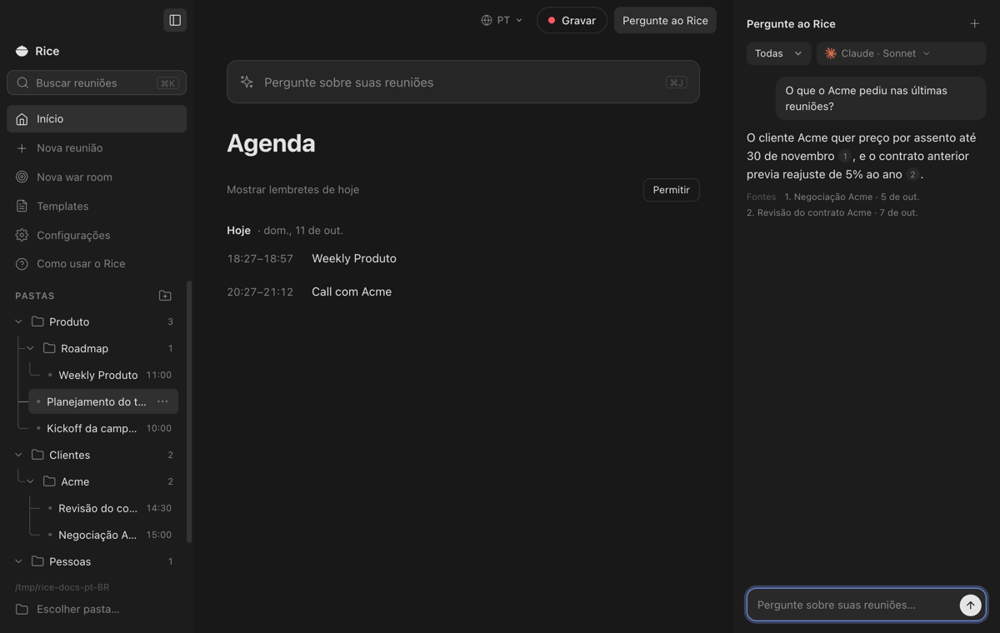

### Mini Rice

Durante a gravação, uma pílula flutua na tela, para você poder sair da janela do Rice. Passe o mouse sobre ela e aparecem **Perguntar** e **Parar**. Clique no logo para trazer o Rice de volta e arraste a pílula pela coluna do logo para movê-la.

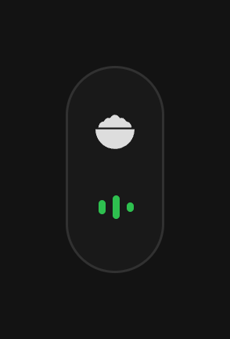
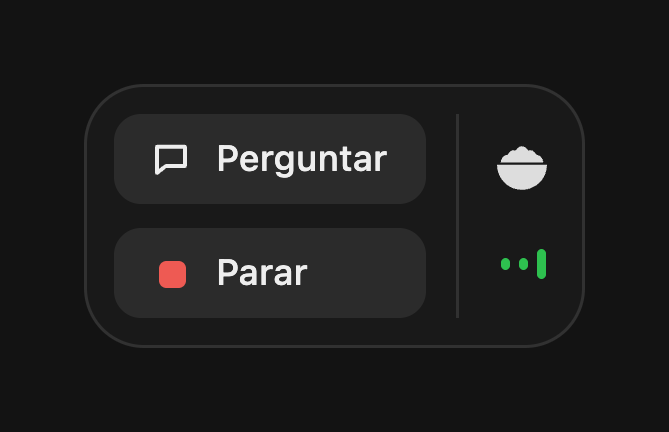

*As duas imagens são a janela real do Mini Rice renderizada sobre um fundo neutro, com o estado de hover forçado.*

### Pastas

Clique no ícone de pasta ao lado de **Pastas** na barra lateral para criar uma. Uma pasta pode ter outras dentro, até 4 níveis: use **⋯ › Nova subpasta**, ou arraste uma pasta sobre outra para movê-la para dentro (solte na borda de cima ou de baixo para só reordenar). Mova uma reunião com **⋯ › Mover para pasta**, cuja lista mostra a árvore, ou arraste-a até a pasta. Linhas finas ligam cada pasta ao que há dentro dela, a contagem inclui as subpastas e aberta ou fechada é lembrado por pasta.

Pastas são apenas rótulos: a reunião continua no mesmo lugar no disco. Apagar uma pasta não apaga nada: as subpastas e as reuniões dela sobem para a pasta-mãe.

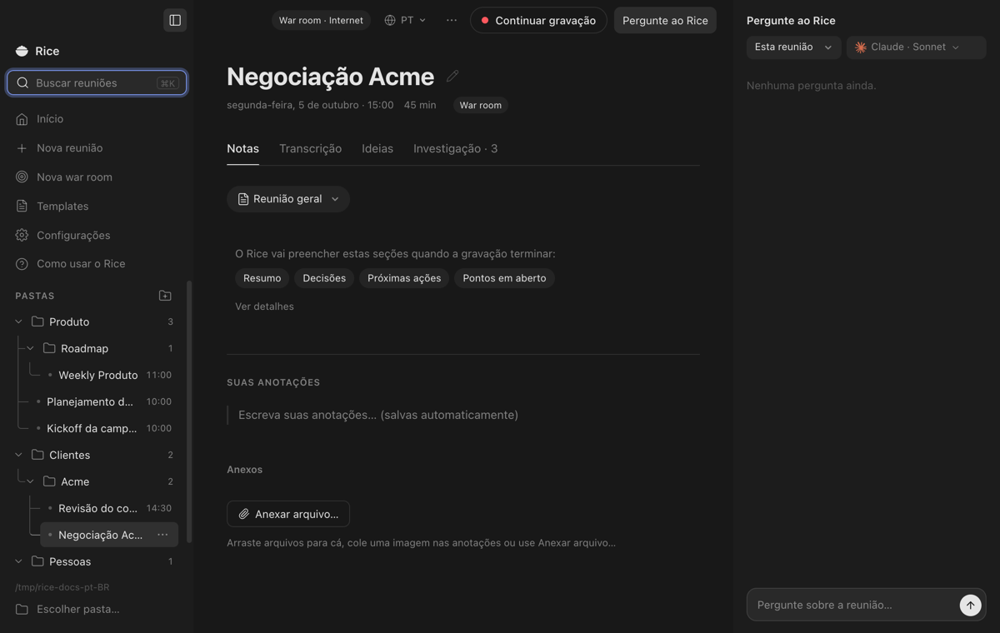

### Busca

Aperte **⌘K** e digite. O Rice busca dentro das reuniões: títulos, notas, anotações e transcrições, sem diferenciar acentos nem maiúsculas, e também o nome da pasta. Cada resultado mostra a data, um trecho de uma linha com as suas palavras em negrito e onde foi achado (nas notas, na transcrição…). Use **↑ ↓** e **Enter** para percorrer os resultados, ou clique em um: a reunião abre já rolada até o trecho, que pisca por um instante. **Esc** limpa a busca.

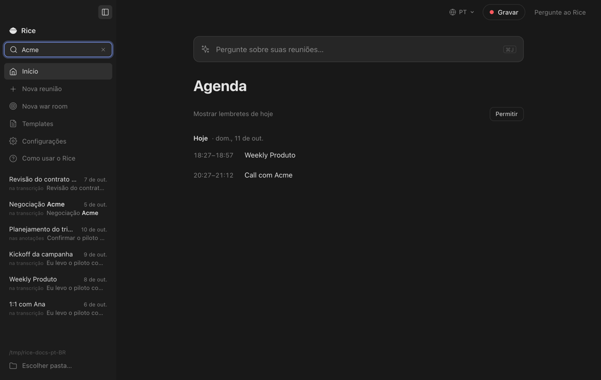

### Compartilhar

O menu **⋯** da reunião tem **Compartilhar**:

- **Copiar notas** coloca as notas na área de transferência formatadas (títulos, listas, tarefas) e em Markdown, então colar no Slack, no Gmail, no Notion ou no Google Docs mantém a formatação. Aparece um pequeno "Notas copiadas".
- **Copiar como Markdown** copia só o Markdown.
- **Rascunho de e-mail de follow-up**: a IA escreve assunto e corpo (agradecimento, resumo curto, decisões, próximos passos com responsáveis) no idioma da reunião. Você edita num diálogo limpo e usa **Copiar** ou **Abrir no Mail**. Se a reunião veio da agenda, os destinatários vêm preenchidos com os participantes, nunca com o seu próprio endereço. Rascunhos longos demais para um link `mailto:` só oferecem Copiar.
- **Exportar PDF…** gera uma página limpa (título, data, participantes, notas e, se você marcar, a transcrição) e pergunta onde salvar.

Não há integração com o Notion, portanto nenhuma credencial extra: use **Copiar notas** e cole no Notion, que converte sozinho.

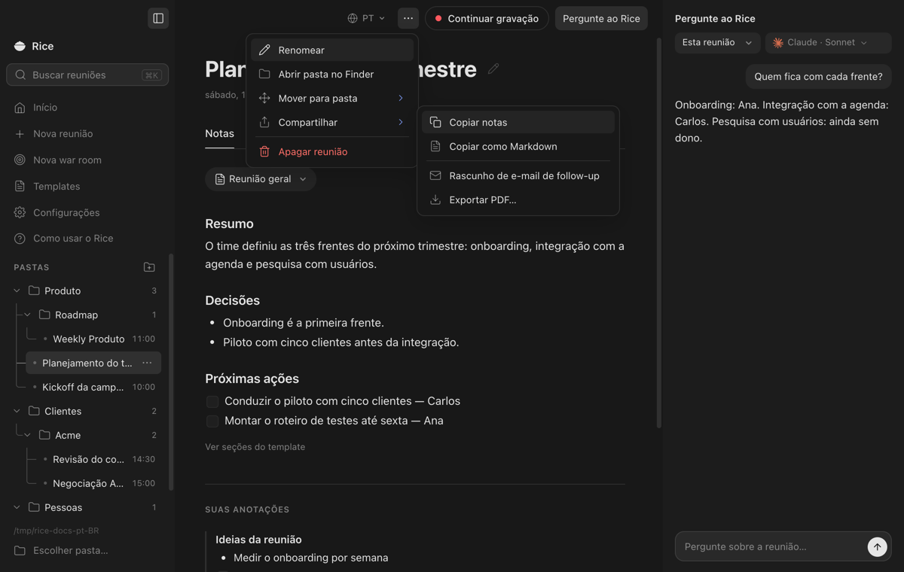
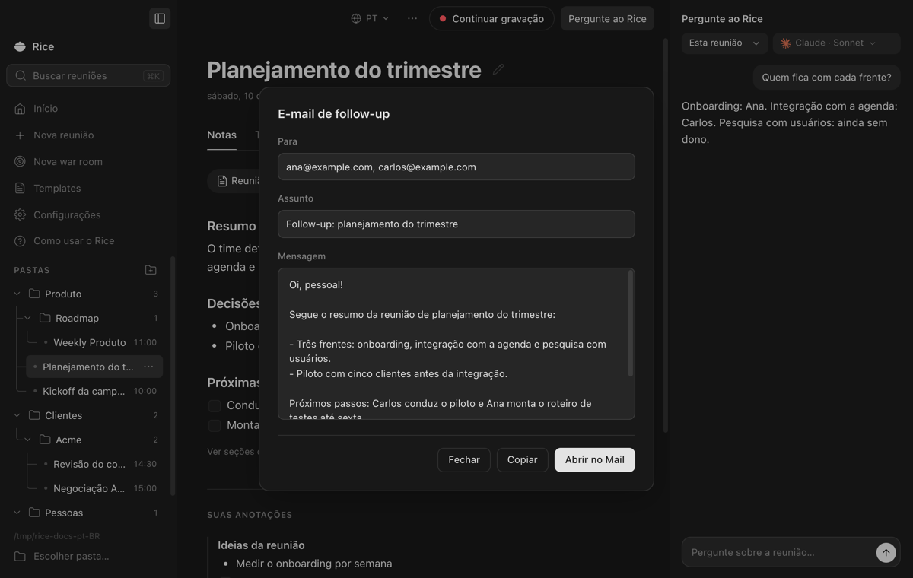

### Idiomas

O **chip com o globo** (PT/EN), no topo de todas as telas, abre uma pequena árvore: **Idioma do app ▸** e **Idioma das reuniões ▸** (dentro de uma reunião ela tem duas seções, **Esta reunião** e **Padrão**). As mesmas duas escolhas estão em **Configurações › Idioma**:

- **Idioma do app**: os textos do Rice (Português ou English).
- **Idioma das reuniões**: a língua falada nas suas reuniões (Português, English ou Automático). Uma língua fixa dá a melhor qualidade. Dá para trocar também só para uma reunião, pelo seletor no topo dela. Não dá para trocar durante a gravação. As notas são escritas no idioma da reunião.

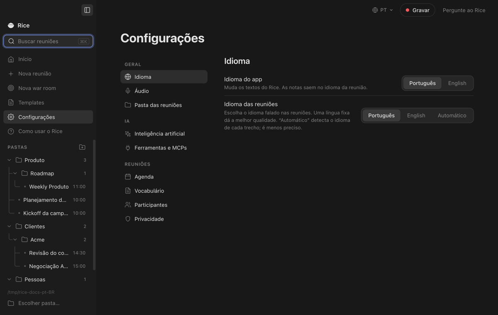

### Apagar uma reunião

**⋯ › Apagar reunião** pede confirmação e depois move a pasta inteira da reunião para a **Lixeira do macOS**, de onde dá para recuperar.

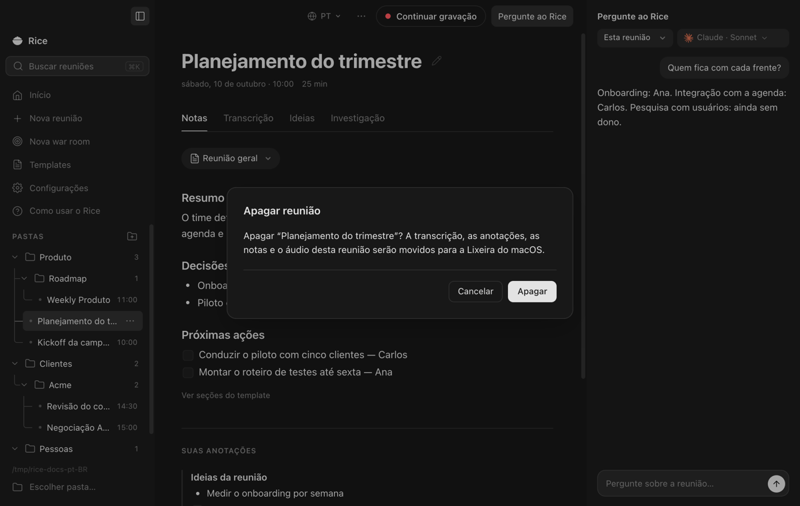

### Ideias ao vivo e War room
**Tipos de ideias.** Na aba Ideias, *Tipo: Geral ▾* escolhe o que a IA sugere: Geral (ideias, perguntas e riscos), Brainstorm, Perguntas para fazer agora, Riscos e objeções, Vendas, Entrevista ou Técnico. Cada um é um template editável (instrução + categorias opcionais) e você cria os seus em **Templates > Ideias** (guardados em `.rice/idea-templates/`). A escolha é por reunião (o último escolhido vira o padrão das novas) e trocar no meio vale a partir do próximo ciclo.

**Nova war room** (barra lateral ou Início) cria uma reunião já no modo War room e abre a aba Investigação; qualquer reunião vira uma por essa aba, e um selo **War room** ao lado da data volta ao normal. As abas Ideias e Investigação ficam na página da reunião, ao lado de Notas e Transcrição, cada uma com uma explicação curta. Durante a gravação, a aba Ideias sugere 1 a 3 ideias, perguntas ou riscos a cada 2, 5, 10 ou 15 minutos (você escolhe), só quando há fala nova. Fixe as boas nas anotações. Em reuniões do tipo War room, a aba Investigação roda ciclos (com intervalo próprio, independente das ideias) e lista os **Achados** conforme chegam, os mais recentes primeiro, cada um com a fonte (URL clicável, ou arquivo dentro da pasta de trabalho revelado no Finder) e o horário. **Fixe** os que importam (vão para o topo e ficam sempre no contexto dos próximos ciclos; os mais recentes entram junto) e **descarte** o resto (com alguns segundos para **Desfazer**). O contador da aba mostra os achados novos desde a última vez que você olhou. *Parar* aborta o ciclo em andamento e *Investigação ativa* pausa a investigação sem perder as fontes. Fontes opcionais, cada uma com aviso e desligada por padrão: Internet (busca e leitura de páginas), MCPs e uma pasta de trabalho somente leitura. Funciona com Claude e Codex por assinatura. Notas e e-mails nunca usam ferramentas.

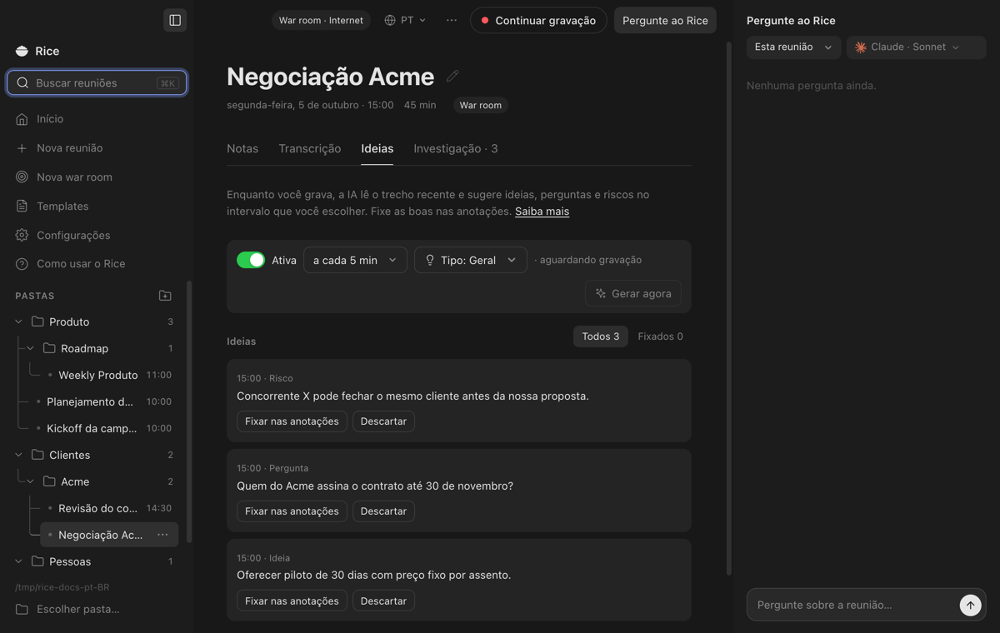

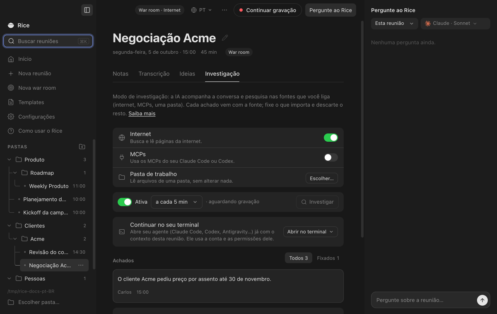

**Continue no seu próprio Claude/Codex.** Na aba Investigação, *Continuar no terminal* abre o seu CLI (Claude Code, Codex, Gemini CLI, Antigravity ou OpenCode, só os que existem no seu Mac) no Terminal, na pasta de trabalho (você escolhe antes; a pasta pessoal, `/` e pastas de credenciais são recusadas), com um prompt para acompanhar a `transcricao.md` ao vivo e investigar. O prompt leva só caminhos de arquivos e os achados que você confirmou, nunca a transcrição. *Copiar prompt* serve para qualquer outro harness ou IDE. O Rice segue gravando e atualizando o arquivo; o outro harness usa as permissões e a conta dele, e o Rice não controla o que ele faz.

## Onde ficam os arquivos

Tudo fica na pasta de reuniões que você escolheu (por exemplo `~/Rice`):

```text
Rice/
├── .rice/
│   ├── folders.json            # as pastas da barra lateral (e qual está dentro de qual)
│   ├── chat-global.jsonl       # o chat entre reuniões
│   └── templates/              # seus templates, um .json cada
└── 2026-10-09 1000 - Planejamento do trimestre/
    ├── meta.json               # título, horário, idioma, template, pasta…
    ├── transcricao.md          # a transcrição
    ├── anotacoes.md            # o que você escreveu em "Anotações"
    ├── anotacoes.json          # o horário de cada linha digitada durante a gravação
    ├── falantes.json           # qual voz é qual pessoa (se "Identificar participantes" estiver ligado)
    ├── extracoes.json          # resumos por partes das reuniões longas
    ├── notas.md                # as notas escritas pela IA
    ├── notas-versoes/          # versões anteriores das notas (até 20) + index.json
    ├── chat.md                 # o chat, legível
    ├── chat.jsonl              # o chat, para o app
    └── audio.m4a               # o áudio (se "Manter o áudio das reuniões" estiver ligado)
```

As configurações do app, os segredos e o modelo de transcrição ficam em `~/Library/Application Support/Rice`.

## Atalhos de teclado

| Atalho | Ação |
| --- | --- |
| **⌘K** | Foca o campo de busca |
| **⌘J** | Pergunta sobre todas as reuniões |
| **↑ ↓ Enter** (na busca) | Percorre os resultados e abre um |
| **Esc** | Limpa a busca / fecha um menu ou diálogo |
| **⌘⌫** | Apaga a reunião aberta (pergunta antes) |
| **⌘,** | Abre as Configurações |
| **↑ ↓ → ← Enter** | Navega por menus e submenus |

## Solução de problemas

**Disco cheio ou pasta indisponível.** O Rice avisa antes de gravar se há menos de 1 GB livre. Se o disco encher durante a reunião, aparece um aviso vermelho, o áudio para de ser salvo e a transcrição continua sendo guardada (na memória e numa cópia local) até haver espaço. Se a pasta das reuniões sumir (volume ejetado, pasta apagada), o Rice recria a pasta ou salva em um local seguro e avisa onde ficou. Libere espaço ou reconecte o volume: o aviso some sozinho e o trecho sem áudio fica marcado na transcrição.

**O Rice fechou no meio da gravação.** Ao abrir de novo, a reunião aparece como "Gravação interrompida". Abra e clique em "Recuperar reunião": o Rice finaliza o áudio, transcreve o que ainda não tinha texto e gera as notas. Também dá para clicar em "Continuar gravação".

**O Mac dormiu durante a reunião.** A gravação continua na mesma reunião; o trecho em repouso aparece como "gravação pausada de … a …" e o áudio do sistema é reconectado.

**"Possível queda do áudio" ou "o microfone perdeu a permissão".** O Rice tenta reconectar sozinho algumas vezes. Se não voltar, use "Abrir permissões" no aviso e ative o microfone (ou a captura de áudio do sistema) para o Rice em Ajustes do Sistema > Privacidade e Segurança.

**"Ainda gravando?"** Depois de 15 minutos sem fala o Rice pergunta; sem resposta em 2 minutos ele para a gravação e oferece "Retomar". Em `settings.json`, `inactivityMinutes` muda o tempo (0 desliga). Gravações com mais de 3 horas ganham um lembrete a cada hora.

**Notas que não saem.** Se o app fechou durante a geração, a reunião mostra "Gerar notas". Falhas de rede têm uma nova tentativa automática; erros de login ou limite de uso pedem ação sua (a mensagem diz qual).

**"Precisa de reparo".** Se o `meta.json` de uma reunião estiver ilegível, ela continua na lista com esse selo; "Reparar reunião" recria título, data e estado pelo nome da pasta e guarda o arquivo ruim como `meta.json.corrompido`.

**Sem áudio do sistema (só a minha voz é transcrita).**
Libere *Gravação de áudio do sistema* para o Rice (ou Electron) em Ajustes do Sistema › Privacidade e Segurança, depois feche e abra o app. Use fones para evitar eco.

**A IA não conecta.**
Clique em **Testar conexão** no provedor. Nas assinaturas o login pode ter expirado: rode `claude setup-token` de novo (e cole o novo token), ou `codex login`. Nas chaves de API, confira se a chave está ativa e com crédito.

**A transcrição está lenta ou o Mac esquenta.**
Feche apps pesados durante a gravação. O modelo quantizado padrão é o mais leve; confira se você não definiu `RICE_WHISPER_MODEL=f16`.

**O `npm run app` diz que o Electron não foi instalado.**
Rode `node node_modules/electron/install.js`.

**O `scripts/build-native.sh` falha.**
Confira se `xcode-select -p` mostra um caminho e se o `brew install meson ninja pkg-config` terminou. A primeira compilação também precisa de internet.

**O Rice diz que falta o `whisper-server`.**
Rode `brew install whisper.cpp` ou aponte `RICE_WHISPER_SERVER` para o binário.

**Atualizar.**
```bash
cd rice
git pull
npm install
scripts/build-native.sh
npm run app
```

### Ferramentas e MCPs (avançado, por sua conta e risco)
Em Configurações > Ferramentas e MCPs no chat você pode deixar o chat usar os MCPs que já configurou no Claude Code (`claude mcp add …`) ou no Codex, por exemplo para criar tarefas no Notion ou no ClickUp a partir de uma reunião. Fica desligado por padrão e vale só para o chat, nunca para notas, e-mails ou extrações. Atenção: o texto da reunião vem de terceiros e pode conter instruções maliciosas; ações de ferramentas podem ser irreversíveis. Cada uso aparece como "Ferramenta usada: servidor · ferramenta". Só Claude e Codex por assinatura.

## Privacidade

- O áudio é gravado e transcrito no seu Mac e nunca sai dele.
- Só texto sai do seu Mac: a transcrição e as suas perguntas vão para o provedor de IA que **você** escolheu, e só quando o Rice gera notas ou responde. O Rice não tem servidores, conta, telemetria nem relatório de erros. O código é aberto (MIT).
- Perguntas entre reuniões e rascunhos de e-mail enviam, para o provedor que **você** escolheu, só as notas e alguns trechos da transcrição das reuniões de que precisam (no máximo 8, com limite de tamanho). A busca roda inteira no seu Mac.
- Tudo o que o Rice cria (áudio, transcrições, notas, conversas, configurações) fica em pastas e arquivos só do seu usuário (permissões 0700/0600). Chaves e tokens ficam no Keychain do macOS.
- Os CLIs de IA rodam sem ferramentas que mexam nos seus arquivos (Claude sem ferramentas; Codex com shell, navegador, computador e plugins desligados; OpenCode com todas as permissões negadas; Antigravity dentro de um sandbox do macOS que só deixa gravar numa pasta temporária vazia, bloqueia comandos e bloqueia a leitura da sua pasta pessoal). O modelo gratuito do OpenCode Zen pode usar suas transcrições para melhorar modelos.
- Os modelos de transcrição e de vozes são baixados uma vez e conferidos por SHA-256. O Google Agenda (opcional) é só leitura; dá para usar a Agenda do macOS no lugar.
- O app só carrega as próprias páginas locais: não navega para sites, não abre janelas nem pede permissões de página.
- Apagar uma reunião a move para a Lixeira; nada fica guardado em outro lugar.
- As leis variam: em muitos lugares é preciso avisar os participantes de que a reunião está sendo gravada.

## Licença

MIT — veja [LICENSE](LICENSE).
